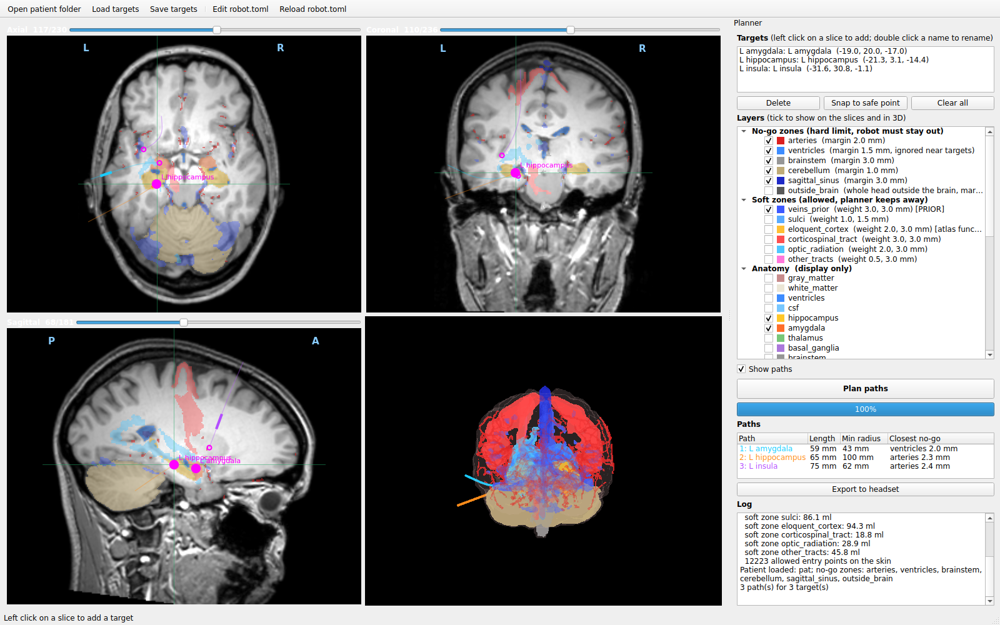
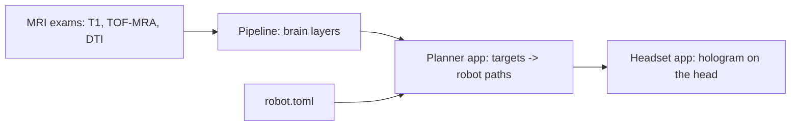

# SEEG Planner

Path planning for a **concentric-tube continuum robot** that carries an SEEG electrode. Starting from the patient's MRI exams, the system builds a 3D model of the brain with every structure that must not be damaged, plans safe **curved** paths to the targets chosen by the surgeon, and shows the brain and the paths as a hologram on the patient's head (Meta Quest 3 for development; optical see-through headsets as the target).

> **Status:** research prototype - **not for clinical use** (clinical use would require medical-device certification, EU MDR). Every path is an automatic proposal that must be reviewed by the surgical team.



## Documentation

Start at **[docs/README.md](docs/README.md)**. The documentation is split into categories; every page has *previous / next* links, so it can be read page by page:

1. [Overview](docs/01-overview/README.md) - what the system does, path planning in plain words, coordinates, glossary
2. [Brain layers and patient data](docs/02-brain-layers/README.md) - pipeline, segmentation, arteries, tracts, veins, priors, layer catalogue, landmarks
3. [Robot and configuration](docs/03-robot-and-config/README.md) - robot model (straight part + 2 arcs), every setting of `robot.toml`
4. [Planner app](docs/04-planner-app/README.md) - how to use the desktop program: targets, target regions, planning, export
5. [Path planning](docs/05-path-planning/README.md) - how the paths are computed, step by step: safety maps, Dijkstra, optimisation, MILP
6. [Headset and Unity](docs/06-headset-and-unity/README.md) - Unity project, running on the Quest, landmark registration, QR head tracking
7. [Tests and results](docs/07-tests-and-results/README.md) - automatic tests, results on the test subject IXI057
8. [Project and repository](docs/08-project/README.md) - repository structure, limitations and roadmap, data sources

## How it works



1. **Pipeline** (`pipeline/`) - segments the brain and extracts the risk layers: arteries, veins, ventricles, nerve tracts, eloquent cortex, skull, skin. Layers that are not measured in this patient are marked as *prior* or *estimate*.
2. **Planner app** (`path_planner/`) - the surgeon clicks targets or outlines target regions on the MRI slices. The planner finds paths of the form *straight part + arc 1 + arc 2* that keep a safety margin from every no-go zone, prefers short and gentle paths away from soft zones, tries to reach several targets with one insertion, and picks the best set of paths with an integer program (MILP).
3. **Headset app** (`unity/`) - loads the brain and the paths, aligns them with the real head by touching facial landmarks with the controller, and follows the head with QR codes.

## Quick start

**1. Build the patient model** (once per patient, ~30 min on a CPU):

```
python pipeline/run_pipeline.py --t1 T1.nii.gz --mra MRA.nii.gz \
    --dti_dir DTI/ --bvals bvals.txt --bvecs bvecs.txt \
    --out results/PATIENT --fastsurfer /path/to/FastSurfer
```

Optional inputs: `--t1_gd` (contrast T1 -> patient veins), `--ct` / `--ct_postimplant`, `--venat` (venous atlas). Details: [Running the pipeline](docs/02-brain-layers/running-the-pipeline.md).

**2. Plan the paths** (desktop app, Windows):

```
cd C:\Users\MSI\Desktop\seeg-planner
.\.venv\Scripts\python.exe path_planner\app.py C:\Users\MSI\Desktop\dataMedical\IXI057
```

or double click `path_planner/run_app.bat`, or build the exe with `path_planner/build_exe.bat`. Left click on a slice = target, **Plan paths**, then **Export to headset**. Details: [Planner app](docs/04-planner-app/README.md).

**3. Show it on the headset**: copy the patient's `headset/` folder into `Assets/StreamingAssets/patient/` of the Unity project, build for the Quest, touch the landmarks. Details: [Headset and Unity](docs/06-headset-and-unity/README.md).

## Repository structure

```
seeg-planner/
├── README.md                    this page
├── requirements.txt             Python libraries of the pipeline
├── docs/                        documentation (8 categories) and images
│
├── pipeline/                    raw exams -> patient layers
│   ├── run_pipeline.py          runs all steps below (resumable)
│   ├── head_mask.py             head / skin mask from T1
│   ├── vessels_mra.py           arteries from TOF-MRA (registration + Frangi filter)
│   ├── tracts_dti.py            9 white-matter tracts from DTI (DIPY)
│   ├── veins_ct1.py             veins and sinuses from contrast T1 (not validated)
│   ├── ct_layers.py             bone, scalp, CTA arteries, implanted contacts from CT
│   ├── structural_extras.py     sulci, skull estimate, sagittal sinus prior
│   ├── atlas_priors.py          venous prior from the VENAT atlas
│   └── seeg_prep.py             layer package: meshes, distance maps, eloquent cortex
│
├── path_planner/                desktop planner app (Python, PySide6) -> Windows exe
│   ├── app.py                   main window: slices, 3D view, targets, regions, planning, export
│   ├── robot.toml               ALL robot limits, no-go / soft zones and planner settings
│   ├── config.py                reads robot.toml
│   ├── patient.py               loads the patient, builds the safety maps
│   ├── planner.py               the path planner (Dijkstra, optimisation, groups, MILP)
│   ├── robot_model.py           robot shape: straight part + arc 1 + arc 2
│   ├── electrode.py             electrode recording contacts
│   ├── regions.py               target regions drawn as outlines
│   ├── export.py                plan.json + paths.glb for the headset
│   ├── headset_scene.py         brain model for the headset with the app's layers
│   ├── layers.py, labels.py     display layers and colours, brain region names
│   ├── view3d.py                3D view (pyqtgraph + OpenGL)
│   ├── run_app.bat              start without building
│   ├── build_exe.bat            build ContinuumPathPlanner.exe
│   └── requirements.txt         libraries of the app
│
├── unity/                       headset app (copy of the Unity scripts)
│   ├── Assets/SeegPlanner/
│   │   ├── PatientLoader.cs     loads brain, paths and manifest; build-safe materials
│   │   ├── DesktopViewer.cs     view on a laptop, edit landmarks, simulated registration
│   │   ├── QuestControls.cs     controllers and help panel on the Quest
│   │   ├── LandmarkRegistration.cs, RigidFit.cs   aligning the hologram with the head
│   │   ├── HeadMarkerTracker.cs following the head with QR codes
│   │   └── Editor/SeegMaterials.cs                materials kept in headset builds
│   ├── Tests/RigidFitTest.cs    registration maths test (runs without Unity)
│   └── README.md                Unity setup in short
│
├── tools/
│   ├── export_headset.py        headset scene, manifest, alignment landmarks, phantom STL
│   ├── registration.py          Kabsch + ICP registration maths (self-test)
│   ├── make_qr_markers.py       printable QR head markers
│   ├── render_preview.py        PNG preview of the patient model
│   ├── render_vessel_check.py   arteries vs expert segmentation (Dice)
│   └── docs_nav.py              rebuilds the navigation of docs/
│
└── tests/
    ├── test_path_planner.py     10 planner tests on a synthetic head
    ├── test_ct_phantom.py       CT layers on a phantom
    └── test_veins_phantom.py    vein extraction on a phantom
```

The Unity project itself is not in the repository, only its scripts. **Patient data is never committed** (`.gitignore`: NIfTI, MGZ, DICOM, GLB, TRK, `results/`, `data/`).

## Patient folder

What the pipeline writes and the planner reads (example `dataMedical/IXI057`):

```
IXI057/
├── orig.nii.gz                         T1, defines the planning grid
├── aparc.DKTatlas+aseg.deep.nii.gz     segmentation (95 regions)
├── mask.nii.gz, head.nii.gz            brain and head masks
├── vessels_auto.nii.gz                 arteries
├── tracts/                             white-matter tracts
├── extras/                             sulci, skull estimate, sagittal sinus prior
├── priors/                             venous prior
├── package/                            meshes, distance maps, manifest
├── targets.json, regions.json          written by the planner app
└── headset/                            everything the headset needs
    ├── headset_manifest.json           layers, coordinate system, landmarks
    ├── patient_scene.glb (+ _lite)     brain model
    ├── paths.glb, plan.json            planned paths (written by Export to headset)
    └── head_phantom.stl                scalp for 3D printing a test phantom
```

## Requirements

| Part | Needs |
|---|---|
| pipeline | Python 3.11, `pip install -r requirements.txt`, [FastSurfer](https://github.com/Deep-MI/FastSurfer) with PyTorch and its weights |
| planner app | Python 3.11, `pip install -r path_planner/requirements.txt` (or the exe) |
| headset app | Unity 6.3 LTS (URP), glTFast, Newtonsoft JSON, Unity OpenXR: Meta; Android Build Support for the Quest |

## Current state

| Part | State |
|---|---|
| pipeline | works on IXI057 (T1, TOF-MRA, DTI); arteries vs experts **Dice 0.78**; veins from contrast T1 and CT layers tested on phantoms only |
| planner app | robot model with 2 arcs, no-go and soft zones, target regions, multi-target paths, MILP selection, electrode contacts, export; single targets planned in ~10-30 s |
| headset app | runs on the Quest 3 (Android build, passthrough); landmark registration confirmed on a real head; QR head tracking written, blocked by the test headset's runtime |

Results: [Results on IXI057](docs/07-tests-and-results/results-ixi057.md). Open points: [Limitations and roadmap](docs/08-project/limitations-and-roadmap.md).

## Tests

```
python tests/test_path_planner.py        # planner, synthetic head
python tests/test_ct_phantom.py
python tests/test_veins_phantom.py
python tools/registration.py             # registration maths self-test
python path_planner/app.py --selftest C:\Users\MSI\Desktop\dataMedical\IXI057   # planner on a real patient, no window
```

What each test checks: [Automatic tests](docs/07-tests-and-results/automatic-tests.md).

## Data sources

IXI dataset (test subject IXI057), expert vessel segmentations for IXI, FastSurfer weights, VENAT venous atlas, MNI152 template - links in [Data sources and safety](docs/08-project/data-sources.md).
