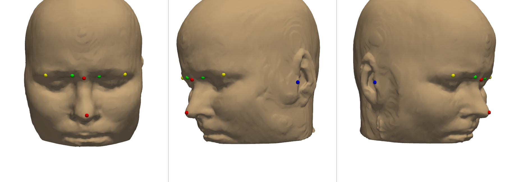
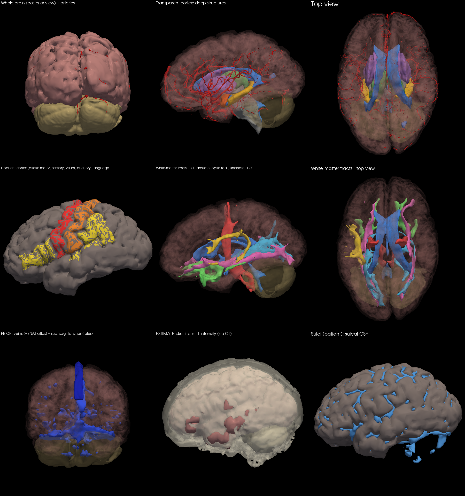
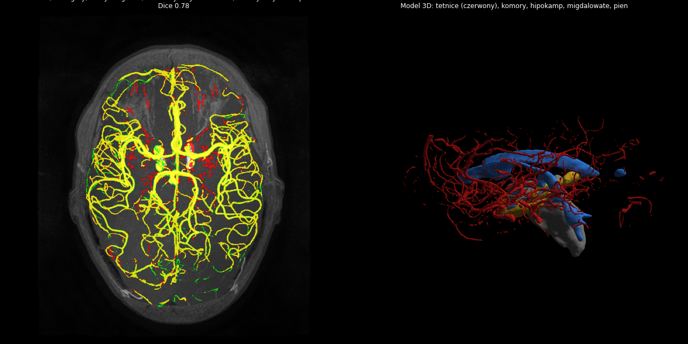

# SEEG Planner

Planning SEEG electrode trajectories on a patient-specific brain model displayed as a hologram in a headset (Meta Quest 3 for development; optical see-through headsets as the target).

**Status:** research prototype. Not for clinical use (would require medical-device certification, EU MDR).

## What the pipeline does

Raw patient exams -> segmentation -> layer extraction -> 3D package ready for planning.

```
python pipeline/run_pipeline.py --t1 T1.nii.gz --mra MRA.nii.gz \
    --dti_dir DTI/ --bvals bvals.txt --bvecs bvecs.txt \
    [--t1_gd T1_gd.nii.gz] [--ct CT.nii.gz --ct_postimplant] \
    [--venat VENAT_PartialVolume.nii.gz] \
    --out results/PATIENT --fastsurfer /path/to/FastSurfer
```

| Step | Script | Input | Output |
|---|---|---|---|
| 1. Brain segmentation | FastSurfer (called from `run_pipeline.py`) | T1 | 95 atlas regions, brain mask |
| 2. Head mask | `pipeline/head_mask.py` | T1 | scalp |
| 3. Arteries | `pipeline/vessels_mra.py` | TOF-MRA + T1 | artery mask (MRA->T1 registration, Frangi filter) |
| 3b. White-matter tracts | `pipeline/tracts_dti.py` | DTI + T1 | corticospinal L/R, arcuate L, optic radiation L/R, uncinate L/R, IFOF L/R (DIPY) |
| 3c. Veins and sinuses | `pipeline/veins_ct1.py` | T1 before + after gadolinium | veins, sinuses (subtraction + 2-scale Frangi) - *not validated* |
| 3d. CT | `pipeline/ct_layers.py` | CT / CTA / post-implant CT | bone + thickness, scalp, CTA arteries, electrode contacts |
| 3e. Structural extras | `pipeline/structural_extras.py` | T1 + segmentation | sulci (patient); skull **estimate** from T1 if no CT; superior sagittal sinus **prior** if no contrast T1 |
| 3f. Venous prior | `pipeline/atlas_priors.py` | T1 + VENAT atlas | probability map of veins, MNI152 -> patient (rigid + affine + B-spline) - **prior**, used if no contrast T1 |
| Eloquent cortex | `pipeline/seeg_prep.py` | segmentation (DKT atlas) | motor, sensory, visual, auditory, language (language: left dominance assumed) |
| 4. Layer package | `pipeline/seeg_prep.py` | masks | `.glb` meshes, distance maps, `manifest.json` |
| 5. Preview | `tools/render_preview.py` | package | PNG with up to 9 views |
| 6. Headset files | `tools/export_headset.py` | package + head mask | `patient_scene.glb` (+ lite), `headset_manifest.json`, alignment landmarks, `head_phantom.stl` |
| 7. Robot path planning | `path_planner/app.py` (desktop app / exe) | patient folder + clicked targets | curved continuum-robot paths, `plan.json` + `paths.glb` for the headset; see [path_planner/README.md](path_planner/README.md) |
| Registration maths | `tools/registration.py` | landmarks / surface points | rigid fit (Kabsch) + ICP, FRE/TRE (self-test) |
| Vessel check | `tools/render_vessel_check.py` | MRA + automatic + expert masks | MIP overlay + Dice |

## Results on test subject IXI057

- Segmentation: ~10 min on CPU (1-2 min with a GPU)
- Arteries vs expert manual segmentation: **Dice 0.78** (sensitivity 0.77, precision 0.80)
- White-matter tracts (DTI, 16 directions, 1.75x1.75x2 mm): CST L 7.8 ml / R 6.6 ml, arcuate L 5.5 ml, optic radiation L 12.1 ml / R 8.3 ml
  - bvec sign convention chosen automatically (mean streamline length 48 mm vs ~25 mm for the wrong variants)
  - IXI: 17 volumes but the gradient table has 16 - tensor fit showed it matches volumes 0-15 (residual 0.051 vs 0.092)
- Tractography ~3 min on CPU (~15 min including automatic bvec convention check)
- Extra tracts: uncinate L 7.4 / R 5.7 ml, IFOF L 9.6 / R 8.1 ml
- Layers without a source exam (clearly labelled in the manifest, `origin`):
  - venous prior (VENAT atlas registered to the patient, ~3 min): 44.8 ml at p > 0.15
  - superior sagittal sinus prior (anatomical rules): 9.6 ml
  - skull estimate from T1 (no CT): 581 ml, median thickness 4.2 mm
- Sulci (patient-derived): 86 ml
- Headset scene: 30 layers, 600k triangles (lite 200k), 8 auto-estimated alignment landmarks (easy to find on the patient)

## Layer origin

| Origin | Layers |
|---|---|
| **patient** (from this subject's exams) | cortex, white matter, deep structures, ventricles, CSF, sulci, scalp, arteries (MRA), 9 tracts (DTI) |
| **patient anatomy + atlas function** | eloquent cortex (DKT gyri; no fMRI; language assumed left-dominant) |
| **prior** (population / rules, not imaged) | veins (VENAT), superior sagittal sinus |
| **estimate** (approximate) | skull from T1 |

Priors and estimates are replaced automatically by patient layers when the exam exists
(contrast T1 -> `veins_ct1.py`, CT -> `ct_layers.py`).

## Headset

```
python tools/export_headset.py --package results/PATIENT/package --head results/PATIENT/head.nii.gz --t1 results/PATIENT/orig.nii.gz --out headset/
```
Unity loader and landmark registration: [unity/README.md](unity/README.md).
Landmarks (nose tip, nasion, inner and outer eye corners, tragus L/R) are found in the head's own anatomical frame,
so they work with a tilted head in the scanner. The eyes are located on the T1 (vitreous = dark ball in bright
orbital fat); eye corners use typical eye dimensions. Check and correct them in the desktop viewer (Edit landmarks).






## Missing / not validated

- Veins and sinuses from the patient: code ready (phantom test), no public patient with pre/post-contrast T1 -> [docs/veins_and_ct.md](docs/veins_and_ct.md); currently replaced by priors
- Unity scripts not yet compiled / tested on the headset
- CT: code ready (phantom test), next step: SEEG patient with CT (Brainstorm Epileptogenicity dataset)
- Eloquent cortex from fMRI instead of the atlas
- White-matter tracts not yet compared with expert tractography

## Tests

```
python tests/test_ct_phantom.py
python tests/test_veins_phantom.py
python tools/registration.py      # landmark + ICP registration self-test
python tests/test_path_planner.py # continuum robot path planner on a synthetic head
```

## Test data

- IXI: https://brain-development.org/ixi-dataset/
- Expert vessel segmentations for IXI: https://zenodo.org/records/17393202
- FastSurfer weights: https://zenodo.org/records/10390573
- VENAT venous atlas (Huck et al. 2019): https://figshare.com/articles/dataset/7205960
- MNI152 template: bundled with nilearn

Patient data is never stored in the repository (`.gitignore`).
