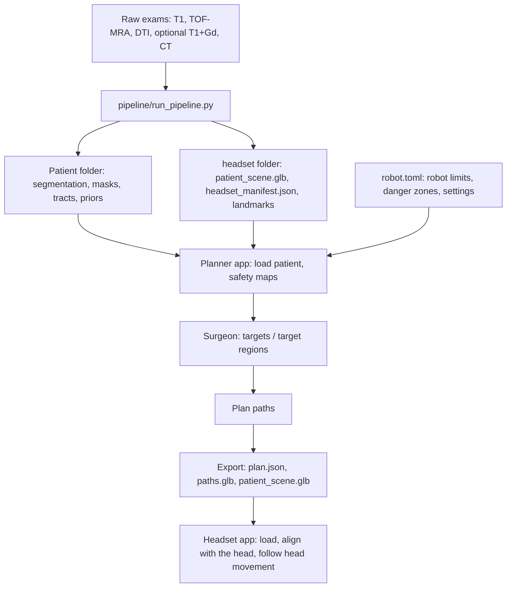

<!-- nav:crumb -->
[Docs home](../README.md) › [Overview](README.md) › **What the system does**
<!-- /nav:crumb -->

# What the system does

> **In short:** from MRI scans of a patient, the system builds a 3D model of the brain with all structures that must not be damaged, plans a safe curved path for a continuum robot to the places the surgeon wants to record from (SEEG), and shows the brain and the path as a hologram on the patient's head.

> **Research prototype, not for clinical use.** Every path is an automatic proposal that has to be reviewed by the surgical team. Clinical use would need medical-device certification (EU MDR).

## Background

**SEEG** (stereo-electroencephalography) records brain activity with thin electrodes placed deep in the brain, to find where epileptic seizures start. Each electrode has several recording **contacts** along it. Today electrodes are straight; this project plans paths for a **concentric-tube continuum robot** that can carry the electrode along a **curved** path, so it can go around dangerous structures and reach several targets with one insertion.

## The three parts

| Part | Where | Language | Job |
|---|---|---|---|
| **Pipeline** | `pipeline/`, `tools/` | Python | raw exams (T1, TOF-MRA, DTI, optional contrast T1 / CT) -> segmentation and risk layers -> headset scene. See [Brain layers](../02-brain-layers/README.md) |
| **Planner app** (desktop, Windows exe) | `path_planner/` | Python, PySide6, pyqtgraph | the surgeon marks targets; the program computes the robot paths and exports them. See [Planner app](../04-planner-app/README.md) and [Path planning](../05-path-planning/README.md) |
| **Headset app** | `unity/Assets/SeegPlanner/` | C#, Unity 6.3 LTS, OpenXR | shows the brain and the paths on the real head (Meta Quest 3 now, optical see-through headsets later). See [Headset and Unity](../06-headset-and-unity/README.md) |

All planning happens on the desktop. The headset only **displays** the result; it never changes the plan.

## Data flow

## Typical session

1. Run the pipeline once per patient (about 30 min on a CPU, mostly segmentation and tractography).
2. Open the patient folder in the planner app; click targets or draw target regions on the MRI slices.
3. Press **Plan paths**; check the paths, their clearances and electrode contacts.
4. **Export to headset**; copy the headset folder into the Unity project and build / run the app.
5. On the headset: touch the alignment landmarks on the head with the controller; the hologram snaps onto the head.

<!-- nav:bar -->
---
← [Overview](README.md) | [↑ Overview](README.md) | [Path planning in plain words](planning-in-plain-words.md) →
<!-- /nav:bar -->
