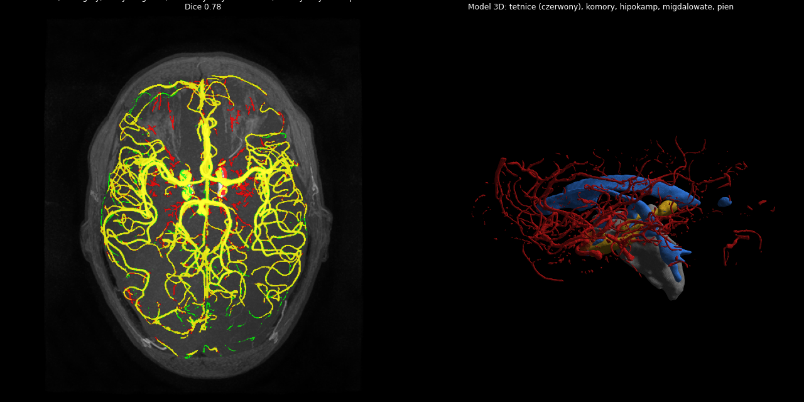

<!-- nav:crumb -->
[Docs home](../README.md) › [Brain layers and patient data](README.md) › **Arteries from TOF-MRA**
<!-- /nav:crumb -->

# Arteries from TOF-MRA

> **In short:** in a TOF-MRA flowing arterial blood is bright. The pipeline aligns the MRA with the T1, enhances tube-shaped bright structures and keeps the brightest ones. Result on IXI057 compared with experts: Dice 0.78.

`pipeline/vessels_mra.py`

| Step | Method | Parameters |
|---|---|---|
| 1. registration MRA -> T1 | SimpleITK rigid (Euler 3D), Mattes mutual information | 32 bins, 5 % random sampling, regular step gradient descent (step 1.0, min 1e-4, 200 iterations), 3 levels: shrink 4/2/1, smoothing 2/1/0 |
| 2. brain mask on the MRA grid | nearest neighbour, dilation 4 iterations | ~2 mm margin keeps surface vessels |
| 3. vesselness | multi-scale **Frangi** filter on intensities normalised to the 1-99.9 percentile of the brain | sigmas 1, 1.5, 2, 3 voxels; alpha = beta = 0.5; bright ridges |
| 4. threshold | vesselness > 97th percentile **and** intensity > 97.5th percentile | flowing blood = brightest 2-3 % of the brain |
| 5. clean-up | closing 1 iteration; components < 30 voxels removed | noise |
| 6. output | mask on the MRA grid with an affine mapped into T1 space | `vessels_auto.nii.gz` (fine MRA resolution kept) |
| 7. validation (optional `--truth`) | Dice, sensitivity, precision vs expert mask | IXI057: Dice 0.78, sensitivity 0.77, precision 0.80 |

**Why Frangi:** it looks at the curvature of the intensity (Hessian eigenvalues) at several scales and responds to "bright tubes" of the given widths, so small and large vessels are both found, while flat bright structures are suppressed.

**Planner role:** no-go zone `arteries`, margin 2 mm (robot surface at least 2 mm away; the robot axis 3 mm). See [No-go and soft zones](../03-robot-and-config/config-no-go-and-soft-zones.md).

<!-- nav:bar -->
---
← [Segmentation and head mask](segmentation-and-head.md) | [↑ Brain layers and patient data](README.md) | [White-matter tracts from DTI](white-matter-tracts.md) →
<!-- /nav:bar -->
