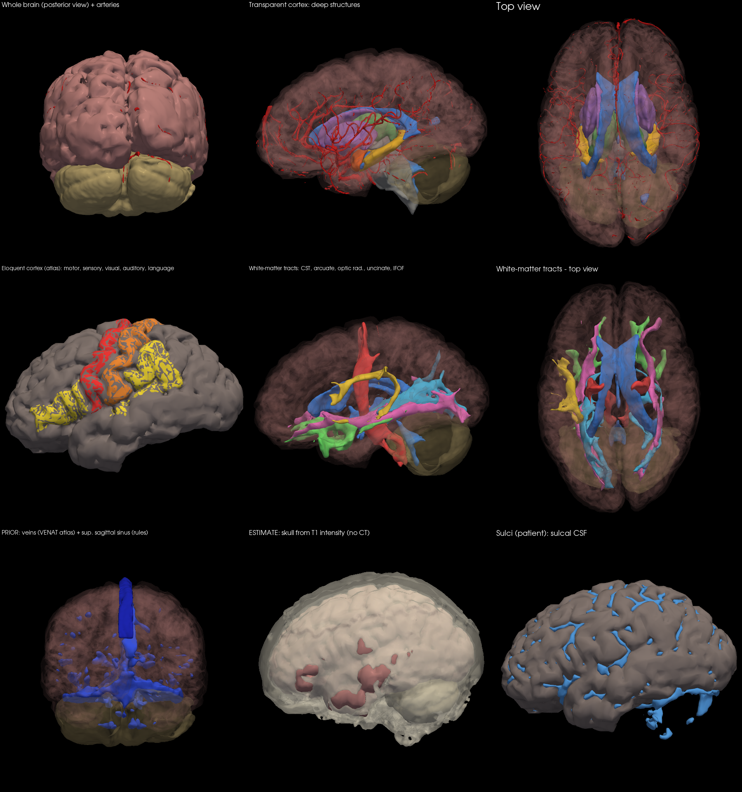
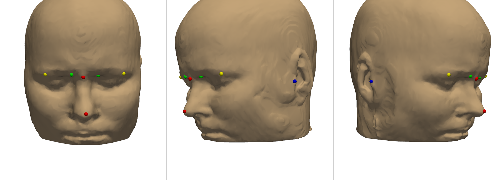

<!-- nav:crumb -->
[Docs home](../README.md) › [Brain layers and patient data](README.md) › **Headset package and landmarks**
<!-- /nav:crumb -->

# Headset package and landmarks

> **In short:** the masks are turned into coloured 3D surfaces in one file the headset can load, plus a manifest that lists the layers, the coordinate transform and the alignment landmarks.

## Layer package (`pipeline/seeg_prep.py`)

`package/`: `meshes/<layer>.glb` (marching cubes, smoothed, decimated to 60 k faces, vessels 150 k), `labels.nii.gz`, `dist_<structure>.nii.gz` (distance maps to critical structures), `manifest.json` (layers, colours, region centroids). `tools/render_preview.py` makes a PNG with up to 9 views.

## Headset files (`tools/export_headset.py`)

| File | Content |
|---|---|
| `patient_scene.glb` | glTF 2.0 scene, one named node per layer, colours and transparency, metres, y up, centred on the head; 600 k triangles |
| `patient_scene_lite.glb` | the same with 200 k triangles (HoloLens 2 / web) |
| `headset_manifest.json` | layers (category, origin, default visibility), coordinate system (`ras_mm_to_scene_m`, `head_centre_ras_mm`), landmarks with touch hints and `touch_order`, region centroids |
| `head_phantom.stl` | scalp surface in mm (max 200 k faces) for 3D printing a 1:1 test phantom |

After **Export to headset** in the planner app, `patient_scene.glb` and the manifest layers are rebuilt with the planner's layer groups (originals kept as `*_pipeline.*`), see [Export to headset](../04-planner-app/export-to-headset.md).

## Landmarks

Found automatically in the anatomical head frame, so they work with a tilted head:

| Landmark | How it is found | Touch hint |
|---|---|---|
| nose tip | facial midline profile (skin within 12 mm of the midline, slice by slice in height); the nose = where the profile sticks out more than 6 mm compared with the cheeks 18-24 mm to the side (not simply the most anterior point: with the chin tucked in, the forehead can be as far forward) | tip of the nose |
| nasion | deepest point of the midline profile between 10 and 60 mm above the nose tip; when the eyes are found, from eye level to 20 mm above it | deepest point of the nose bridge |
| eye corners (inner / outer, L / R) | eyes located on the T1 as dark vitreous balls; inner corner 16 mm, outer 13 mm (+2 mm up) from the eye centre, snapped to the skin | eye closed |
| tragus (L / R) | the pinna = what disappears from the head mask after an opening with a 5 mm ball; tragus = front edge of the pinna at mid-height, snapped to the skin | small flap in front of the ear canal |

Touch order: nose tip, nasion, right inner eye corner, right outer eye corner, right tragus, left inner eye corner, left outer eye corner, left tragus. Landmarks can be corrected in the Unity desktop viewer (**Edit landmarks**).

They are used twice: for [aligning the hologram](../06-headset-and-unity/landmark-registration.md) and for the [allowed skin entry zone](../03-robot-and-config/config-entry-zone.md) of the planner.

<!-- nav:bar -->
---
← [Layer catalogue](layer-catalogue.md) | [↑ Brain layers and patient data](README.md) | [Robot and configuration](../03-robot-and-config/README.md) →
<!-- /nav:bar -->
