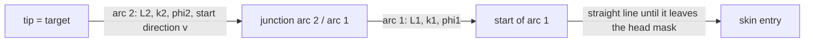

<!-- nav:crumb -->
[Docs home](../README.md) › [Robot and configuration](README.md) › **Robot model**
<!-- /nav:crumb -->

# Robot model

> **In short:** the robot is a straight tube followed by two pre-curved tubes. Every path is therefore *straight line + circular arc 1 + circular arc 2*, described by 8 numbers. The planner searches for good values of these numbers.

Code: `path_planner/robot_model.py`

## The three parts

| Part | What it is | Length | Bend | Colour |
|---|---|---|---|---|
| straight part | pushed in first, through skin and bone and on into the brain | any, at least `min_straight_mm` = 15 mm | none | cyan |
| arc 1 | outer pre-curved tube coming out of the straight part | 0 - 35 mm | radius >= 50 mm (curvature <= 1/50 mm⁻¹) | yellow |
| arc 2 | thinner inner pre-curved tube coming out of arc 1, carries the tip | 0 - 35 mm | radius >= 30 mm (curvature <= 1/30 mm⁻¹) | orange |

Each tube can be **rotated** about its axis, so each arc bends in its own plane (angles $`\varphi_1`$, $`\varphi_2`$). Any radius above the minimum is allowed, and an arc may have length 0 - a fully straight path is a valid shape. The path list shows e.g. `straight 31 | arc 1 24 mm R 131 | arc 2 5 mm R 79`.

**Why the inner tube may bend more:** the strain in a bent tube is about $`\varepsilon \approx r_{\text{tube}}/R_{\text{bend}}`$. A thinner tube reaches the same strain at a smaller bend radius. The values 50 / 30 mm are placeholders until the real robot is built.

## Circular arc formula

`robot_model.arc(p, v, κ, L, φ)`: an arc starting at point $`p`$ with unit tangent $`v`$. A fixed reference normal $`n_0 = \text{normalise}(v \times \hat z)`$ (or $`v \times \hat y`$ if $`v \parallel \hat z`$) is rotated by $`\varphi`$ to get the bending direction:

```math
b = \cos\varphi\; n_0 + \sin\varphi\;(v \times n_0)
```

Points at arc length $`s \in [0, L]`$ (every `sample_step_mm` = 1 mm) and the tangent at the end:

```math
p(s) = p + \frac{\sin(\kappa s)}{\kappa}\, v + \frac{1 - \cos(\kappa s)}{\kappa}\, b,\qquad
v_{\text{end}} = \cos(\kappa L)\,v + \sin(\kappa L)\,b
```

The bending angle of an arc is $`\kappa L`$; the result field `total_turn_deg` is $`\kappa_1 L_1 + \kappa_2 L_2`$ in degrees. $`\kappa`$ is clamped to at least $`10^{-9}`$, so $`\kappa \to 0`$ gives the straight line $`p + s v`$.

## Building the shape backwards from the target

> **Why backwards:** the tip must be exactly on the target. Starting the construction at the target guarantees it, so the optimiser never has to "aim". The entry point on the skin is a result, not an input.



1. $`v`$ = unit direction from the tip back along the robot;
2. arc 2 from the tip with $`(\kappa_2, L_2, \varphi_2)`$ -> its end tangent $`v_1`$;
3. arc 1 with $`(\kappa_1, L_1, \varphi_1)`$ -> end point $`P_0`$ and back direction $`v_b`$;
4. straight line $`P_0 + t\,v_b`$, sampled every 0.5 mm up to `max_length_mm` + 1, until the head mask value (trilinear) drops below 0.5; the crossing is interpolated linearly:

```math
L_0 = t_{i-1} + \frac{h_{i-1} - 0.5}{h_{i-1} - h_i}\,(t_i - t_{i-1}),\qquad \text{entry} = P_0 + L_0\, v_b,\qquad u = -v_b
```

$`u`$ is the insertion direction. If the line never leaves the head the shape is invalid. `robot_model.assemble` joins straight part, arc 1 and arc 2 into one polyline from the entry to the tip, with a label per point (0 straight, 1 arc 1, 2 arc 2).

## The 8 shape numbers

| Number | Meaning |
|---|---|
| $`a, b`$ | tip direction $`v`$ (2 numbers, see [Shape optimisation](../05-path-planning/shape-optimisation.md)) |
| $`L_2, \kappa_2, \varphi_2`$ | arc 2: length, curvature, plane |
| $`L_1, \kappa_1, \varphi_1`$ | arc 1: length, curvature, plane |

The straight length $`L_0`$ is not free: it follows from where the line meets the skin.

<!-- nav:bar -->
---
← [Robot and configuration](README.md) | [↑ Robot and configuration](README.md) | [The configuration file robot.toml](configuration-file.md) →
<!-- /nav:bar -->
