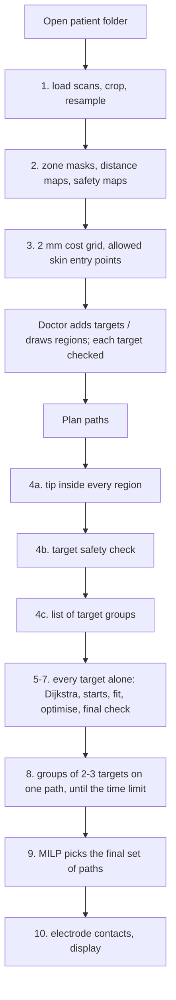

<!-- nav:crumb -->
[Docs home](../README.md) › **Path planning**
<!-- /nav:crumb -->

# Path planning

How the program finds the robot paths, step by step **in the order the code runs**, with all formulas, weights and default values. A plain-words version is in [Planning in plain words](../01-overview/planning-in-plain-words.md); the robot shape is defined in [Robot model](../03-robot-and-config/robot-model.md).

<!-- nav:pages -->
## Pages in this category

1. [Loading the patient](loading-the-patient.md) - one grid for all scans, crop, resampling
2. [Safety maps](safety-maps.md) - zone masks, midline, distance maps, clearance, soft map
3. [Route grid and entry points](route-grid-and-entry-points.md) - 2 mm cost grid, allowed skin points, normals, entry angle
4. [Targets check and region tips](targets-check-and-region-tips.md) - best tip inside a region, target safety check
5. [Planning one path](planning-one-path.md) - Dijkstra, entry candidates, straight entries, fitting the robot shape
6. [Shape optimisation](shape-optimisation.md) - variables, cost, fines and weights, penalty continuation, examples
7. [Final check and best result](final-check.md) - strict checks, result record, alternatives
8. [Several targets on one path](several-targets-on-one-path.md) - group list, order test, exact arc shapes, pruning, time limit
9. [Choosing the paths (MILP)](choosing-the-paths-milp.md) - why a MILP, formulation, conflicts, worked example
10. [Electrode contacts](electrode-contacts.md) - contact positions, targets on contacts
<!-- /nav:pages -->

## Order of execution

| When | Step | Page | Code |
|---|---|---|---|
| opening a patient | load and resample scans | [Loading the patient](loading-the-patient.md) | `patient.Patient` |
| opening a patient | safety maps | [Safety maps](safety-maps.md) | `Patient.build_fields` |
| opening a patient | cost grid, skin entry points | [Route grid and entry points](route-grid-and-entry-points.md) | `Planner.__init__` |
| Plan paths | region tips, target check | [Targets check and region tips](targets-check-and-region-tips.md) | `Planner.region_tip`, `check_target` |
| Plan paths | list of groups (made before the single paths, planned after them) | [Several targets on one path](several-targets-on-one-path.md) | `_candidate_groups` |
| Plan paths | every target alone: route, starts, fit | [Planning one path](planning-one-path.md) | `plan_sequence`, `_optimise` |
| Plan paths | optimisation | [Shape optimisation](shape-optimisation.md) | `_evaluate`, `_refine` |
| Plan paths | strict check, best result, alternatives | [Final check](final-check.md) | `_result`, `alternatives` |
| Plan paths | groups of 2-3 targets | [Several targets on one path](several-targets-on-one-path.md) | `_arc_inits`, `_optimise_via`, `_cannot_win` |
| Plan paths | final choice | [Choosing the paths (MILP)](choosing-the-paths-milp.md) | `_select`, `conflicts` |
| after planning | contacts | [Electrode contacts](electrode-contacts.md) | `electrode.py` |

Planning runs in a background thread; **Stop** is checked every 200 optimiser evaluations and raises `Cancelled`; paths found so far are kept. Typical time on IXI057: ~10-30 s per single target; groups until `time_limit_s` (240 s).

<!-- nav:bar -->
---
← [Export to headset](../04-planner-app/export-to-headset.md) | [↑ Docs home](../README.md) | [Loading the patient](loading-the-patient.md) →
<!-- /nav:bar -->
