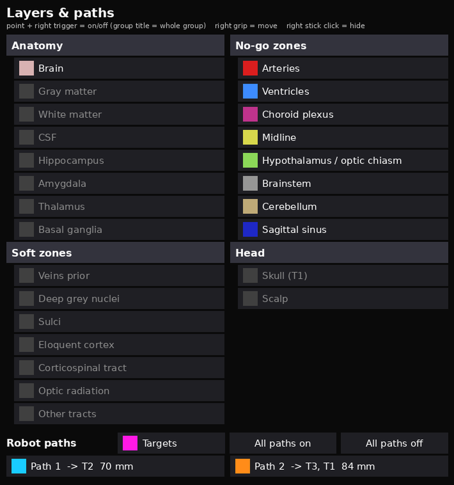

<!-- nav:crumb -->
[Docs home](../README.md) › [Headset and Unity](README.md) › **Controls and help panel**
<!-- /nav:crumb -->

# Controls and help panel

> **In short:** the right controller has a red pen tip for touching landmarks; buttons show/hide the hologram and the skin, restart, skip a landmark, and the left grip carries the brain by hand. A help panel above the left controller always says what to do next. A second, movable **Layers & paths** panel switches brain layers and robot paths on and off.

`QuestControls.cs` (works over Link and in the Android build; does nothing without a headset).

## Buttons

| Button | Action |
|---|---|
| Right trigger | record the current landmark at the red pen tip (8 cm in front of the right controller, 2 cm down); while the laser points at the Layers & paths panel it clicks the panel instead |
| Left Y / left stick click | skip the current landmark (e.g. eye corners that are hard to reach); at least 3 must be touched |
| Right B | start again: forget all touched points, stop following the head markers, hologram visible in front of you (0.5 m, facing you) |
| Right A | hologram on / off (to look at the real head) |
| Left X | skin (scalp layer) on / off, to check the fit |
| Left grip (hold) | carry the hologram with the left controller (manual placement); pauses marker following; on release, if the hologram follows the head markers, it is re-anchored at the new place |
| Right stick click | Layers & paths panel on / off |
| Right grip (hold, pointing at the panel) | drag the Layers & paths panel; it keeps facing you and stays where you release it |

## Help panel

A world-space UI panel (uGUI, 600 px scaled to 0.24 m) floats above the left controller, or low in front of the face when the left controller is not tracked. It shows:
- the landmark to touch now, in capitals, with its hint from the manifest (e.g. "deepest point of the nose bridge, between the eyes") and "patient's own left / right";
- the last status ("Recorded: nasion. Fit error (FRE) 2.3 mm", "Anchored to the head marker(s)", ...);
- the marker status line ([Head tracking with markers](qr-head-tracking.md));
- the button list and the **last button** pressed, so a button that seems to do nothing is easy to spot.

(The panel uses uGUI with the built-in font because the font shader of the old `TextMesh` text is stripped from builds - the earlier help text was invisible on the headset.)

## Layers & paths panel

`LayerPanel.cs` (added automatically by `QuestControls`). It is visible from the start, 0.65 m in front of you and 0.25 m to the right, about 0.42 m wide.

- **Layers:** the same layers, groups (Anatomy, No-go zones, Soft zones, Head) and colours as the planner app's layer list, read from `headset_manifest.json`. A grey square = layer hidden. Click a layer to switch it; click a group title to switch the whole group (if anything in the group is visible, all of it is hidden, otherwise all of it is shown).
- **Robot paths:** one row per path from `plan.json` (id, targets, length). A row switches every part of that path (`path_<n>_straight`, `_arc1`, `_arc2`, `_contacts`, `_contacts_on_target`, or `path_<n>` from older exports). **Targets** switches all target spheres; **All paths on / off** switches every path.
- **Pointing:** the right controller's ray is intersected with the panel plane; a cyan laser and dot show where it points and the row under it is highlighted. While pointing at the panel the pen tip is hidden and the right trigger clicks the panel (no landmark is recorded).
- The colours always show the real state of the layers, so changes made with buttons (e.g. X = skin) appear on the panel too.
- No EventSystem or XR Interaction Toolkit is needed: the clicks are found geometrically, uGUI is used only for drawing.

<!-- nav:bar -->
---
← [Running on the Quest](running-on-the-quest.md) | [↑ Headset and Unity](README.md) | [Landmark registration](landmark-registration.md) →
<!-- /nav:bar -->
