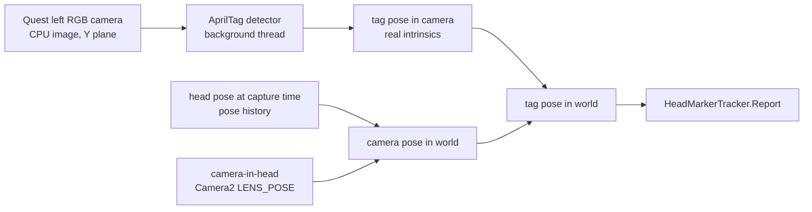

<!-- nav:crumb -->
[Docs home](../README.md) › [Headset and Unity](README.md) › **Head tracking with markers**
<!-- /nav:crumb -->

# Head tracking with markers

> **In short:** after registration the hologram is fixed in the room. If the person moves the head, the hologram would stay behind. Markers fixed on the head (headband; in the operating room the head clamp) are tracked by the headset; the hologram is tied to them and moves with the head. Default markers: **AprilTags** found in the Quest's own camera image. QR codes through the headset's marker tracking are kept as an option, but they do not work on the test Quest 3.

`HeadMarkerTracker.cs` (added automatically by `QuestControls`) and `AprilTagCameraSource.cs` (added automatically by `HeadMarkerTracker`).

**Why:** the hologram must stay on the head without registering again after every movement of the person.

## How it works

1. **Registration** puts `PatientRoot` on the head ([Landmark registration](landmark-registration.md)).
2. **Calibrate** (automatically after every landmark from the 3rd on, and when the grip is released): for every head marker visible now, the pose of the hologram relative to the marker is stored:

```math
T_{\text{marker}\leftarrow\text{root}} = T_{\text{world}\leftarrow\text{marker}}^{-1}\; T_{\text{world}\leftarrow\text{root}}
```

3. **Every frame:** each visible anchored marker predicts where the hologram should be,

```math
T_{\text{world}\leftarrow\text{root}} = T_{\text{world}\leftarrow\text{marker}}(\text{now})\;T_{\text{marker}\leftarrow\text{root}}
```

   the predictions are averaged (positions averaged; quaternions flipped into the same hemisphere, summed and normalised) and smoothed:

```math
k = 1 - e^{-\Delta t / 0.2\,\text{s}},\qquad p \leftarrow p + k\,(p_{\text{target}} - p),\qquad q \leftarrow \text{slerp}(q, q_{\text{target}}, k)
```

   jumps larger than 10 cm snap at once ($`k = 1`$). A marker counts as visible if it was seen in the last 0.4 s. With no marker visible the hologram keeps its last pose.
4. Markers that were not visible during calibration are **added automatically** the first time they are seen together with an already anchored marker (a headband with 3 markers keeps working when the head turns).
5. Anchors are stored per marker id (`TAG-0`, `TAG-1`, ... or the QR text).

## AprilTag camera source



- **Image:** Unity OpenXR: Meta 2.6 "Image capture" (`ARCameraManager.TryAcquireLatestCpuImage`, left camera, YUV 4:2:0; only the brightness plane is used).
- **Detector:** package `jp.keijiro.apriltag` 1.0.3 (native AprilTag library, Android arm64), family **tagStandard41h12**, run on a background thread on at most one image at a time (up to 15 images/s, quad decimation 2, Hamming distance ≤ 1, decision margin ≥ 25).
- **Pose of the tag in the camera:** AprilTag's pose estimation with the real camera intrinsics $`f_x, f_y, c_x, c_y`$ (scaled to the image size). AprilTag returns $`R, t`$ in the OpenCV camera frame (x right, y down, z forward); in Unity's camera frame (x right, y up, z forward)

```math
t' = S\,t,\qquad R' = S\,R\,S,\qquad S = \operatorname{diag}(1, -1, 1)
```

- **Camera in the head:** read once from Android Camera2 (`LENS_POSE_TRANSLATION`, `LENS_POSE_ROTATION` of the camera with Meta's metadata `camera_source = 0`, `position = 0`) and converted exactly as in Meta's `PassthroughCameraUtils`: $`p = (t_0, t_1, -t_2)`$, $`q_{cam\leftarrow head} = (-r_0, -r_1, r_2, r_3)`$, camera rotation in the head $`= q_{cam\leftarrow head}^{-1}\cdot \text{Euler}(180°, 0, 0)`$.
- **Latency:** the head pose is taken at the moment the image was captured, not now: the tracker keeps a short history of head poses and interpolates it at (now − image age). The image age comes from the image timestamp compared with Android's clocks; if that does not work, 50 ms is assumed (shown as "(assumed)").
- **Check:** every detected tag gets a **green frame** in the hologram. It must lie exactly on the edge of the tag's inner white square. If it is shifted or tilted, the camera pose or the tag size is wrong.

## Markers

`python tools/make_apriltag_markers.py` (needs `reportlab`) writes `seeg_apriltag_markers.pdf`:
- page 1: headband set, tag 0 (forehead), tag 1 (her left side), tag 2 (her right side), inner square 40 mm (whole tag 72 mm);
- page 2: one large tag 3, inner square 55 mm.

**Tag size** for the pose estimation = edge of the **inner** square = 5 of the 9 cells of a tagStandard41h12 tag (checked on a synthetic image and on the rendered PDF). Print at 100 % and check the 100 mm scale bar; **printScale** = 0.95 because the university printer prints 100 mm as 95 mm. Glue the tags flat onto stiff cardboard; they must not bend or slide on the head.

## Settings

| Component | Setting | Default | Meaning |
|---|---|---|---|
| HeadMarkerTracker | `headPrefixes` | `TAG-`, `SEEG-HEAD` | ids treated as head markers |
| HeadMarkerTracker | `printScale` | 0.95 | real printed size / nominal size |
| HeadMarkerTracker | `smoothing` | 0.2 s | time constant (0 = no smoothing) |
| HeadMarkerTracker | `snapDistance` | 0.10 m | larger jumps are applied at once |
| HeadMarkerTracker | `freshSeconds` | 0.4 s | how long a marker counts as visible |
| HeadMarkerTracker | `useAprilTags` / `useQrCodes` | on / off | marker sources |
| AprilTagCameraSource | `headbandTagMm` / `largeTagMm` | 40 / 55 | nominal inner-square sizes (tags 0-2 / tag 3) |
| AprilTagCameraSource | `maxRateHz` | 15 | images analysed per second |
| AprilTagCameraSource | `decimation` | 2 | 1 = finds smaller / farther tags, slower |
| AprilTagCameraSource | `minDecisionMargin` | 25 | weaker detections are ignored |
| AprilTagCameraSource | `showOverlay` | on | green frame on detected tags |

Project Settings -> XR Plug-in Management -> OpenXR (Android) -> Meta Quest feature group -> gear of **Meta Quest: Camera (Passthrough)** -> **Camera Image Support** on. This adds the camera permissions to the Android manifest. The app asks for `horizonos.permission.HEADSET_CAMERA` at start and restarts the camera after "Allow". Package: scoped registry `Keijiro` (`https://registry.npmjs.com`, scope `jp.keijiro`) + `jp.keijiro.apriltag` in `Packages/manifest.json`.

## Status line on the panel

e.g.

```
Markers FOLLOWING: TAG-0 0.55m*  TAG-1 0.61m (lost)*
AprilTag camera 14 Hz, 1 tag(s), latency 38 ms
```

per marker: id, distance from the headset, `(lost)` = not seen now, `*` = anchored; mode `FOLLOWING`, `PAUSED (grip)` or `not anchored`. Second line: images per second, tags in the last image, image latency; or the camera state (`waiting for camera permission`, `no camera image - enable 'Camera Image Support'`, `camera pose: DEFAULT (...)` if the camera-in-head pose could not be read).

## QR codes (optional, not working on the test headset)

QR codes through AR Foundation's `ARMarkerManager` with the package "Unity OpenXR: Spatial Entities" (`useQrCodes`). `python tools/make_qr_markers.py` writes the QR sheets (`SEEG-HEAD-<n>-<size>MM`). On the test Quest 3 (OpenXR runtime 209.161, personal account) the runtime does **not** offer `XR_EXT_spatial_entity` nor any other spatial-entity / scene extension, so AR Foundation gets no marker provider (`QR: no marker provider`). That is why the AprilTag camera source was added (2026-11-11).

<!-- nav:bar -->
---
← [Landmark registration](landmark-registration.md) | [↑ Headset and Unity](README.md) | [Troubleshooting](troubleshooting.md) →
<!-- /nav:bar -->
