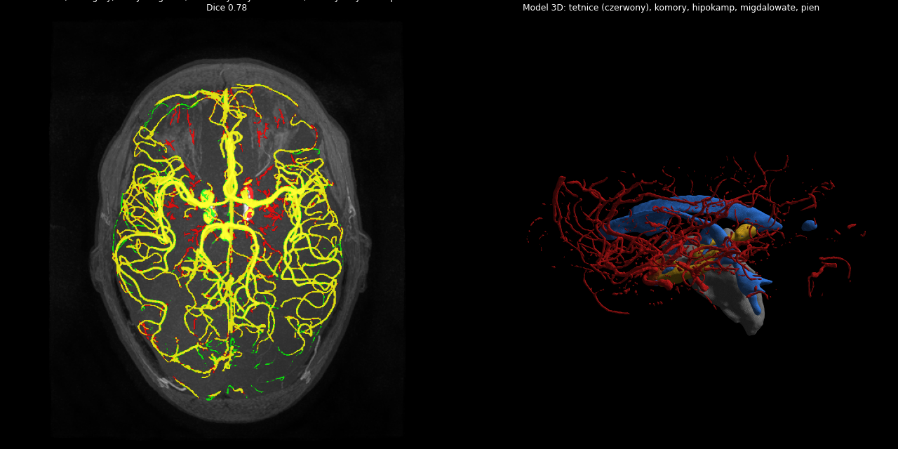
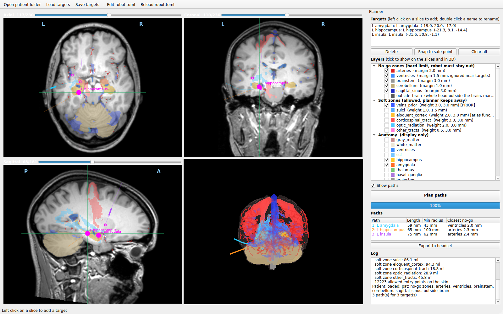

<!-- nav:crumb -->
[Docs home](../README.md) › [Tests and results](README.md) › **Results on IXI057**
<!-- /nav:crumb -->

# Results on IXI057

Test subject from the public IXI dataset (T1, TOF-MRA, DTI; no contrast T1, no CT).

## Pipeline

| Item | Result |
|---|---|
| segmentation | ~10 min CPU (1-2 min GPU) |
| arteries vs expert segmentation | **Dice 0.78**, sensitivity 0.77, precision 0.80 |
| tracts (16 directions, 1.75 x 1.75 x 2 mm) | CST L 7.8 / R 6.6 ml, arcuate L 5.5 ml, optic radiation L 12.1 / R 8.3 ml, uncinate L 7.4 / R 5.7 ml, IFOF L 9.6 / R 8.1 ml |
| bvec convention (automatic) | mean streamline 48 mm vs ~25 mm for wrong variants |
| tractography | ~3 min (~15 min with the automatic convention check) |
| venous prior (VENAT) | 44.8 ml at p > 0.15, ~3 min |
| superior sagittal sinus prior | 9.6 ml |
| skull estimate | 581 ml, median thickness 4.2 mm |
| sulci | 86 ml |
| headset scene | 30 layers, 600 k triangles (lite 200 k), 8 auto-estimated landmarks |

## Planner

- single targets: feasible paths in ~10-30 s each;
- groups of several targets on one path are rarely feasible with the current robot limits (e.g. superior temporal gyrus -> insula crosses the middle cerebral artery branches in the Sylvian fissure);
- self-test (left hippocampus) passes.

## Headset

- Android build runs on the Quest 3 with passthrough; alignment with a real head by landmarks confirmed;
- QR head tracking blocked by the test headset's runtime ([QR head tracking](../06-headset-and-unity/qr-head-tracking.md)).

<!-- nav:bar -->
---
← [Automatic tests](automatic-tests.md) | [↑ Tests and results](README.md) | [Project and repository](../08-project/README.md) →
<!-- /nav:bar -->
