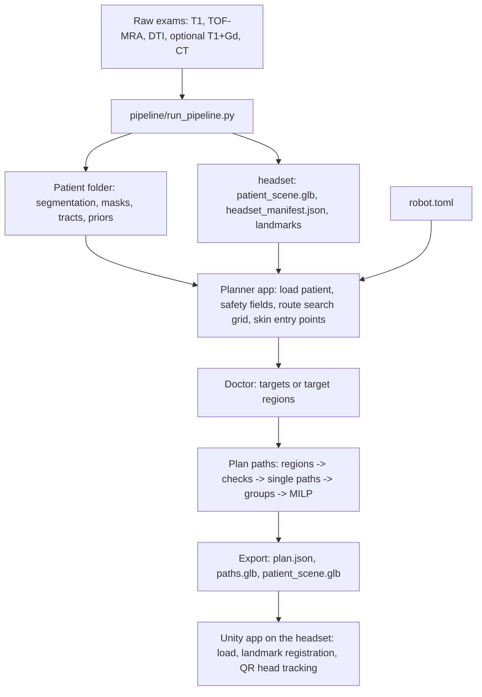
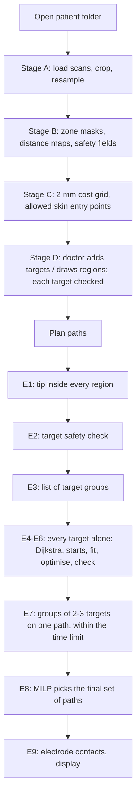

# SEEG Planner: technical documentation

How the system turns raw MRI exams into a safe curved path for a concentric-tube continuum robot and shows it as a hologram on the patient's head.

The document has two levels:
- **"In short" / "Why" boxes** explain in plain words what a step does and why it is there;
- the text around them gives the **full description**: algorithm, formulas, weights and default values, so the behaviour can be checked against the code.

The planning chapters (Part III) follow **the order in which the program actually runs**.

> **Research prototype, not for clinical use.** Every path is an automatic proposal that has to be reviewed by the surgical team. Using it clinically would need medical-device certification (EU MDR).

All numbers are the defaults of [`path_planner/robot.toml`](../path_planner/robot.toml) unless stated otherwise. Code version: `path_planner/` with `robot_model.py` (straight part + 2 arcs), electrode contacts, target regions; Unity scripts with QR head tracking (state 2026-11).

---

## Table of contents

**Part I Overview**
1. [System overview](#1-system-overview)
2. [Planning in plain words](#2-planning-in-plain-words)
3. [Coordinate systems and units](#3-coordinate-systems-and-units)

**Part II Patient model**

4. [Building the patient model (pipeline)](#4-building-the-patient-model-pipeline)

**Part III Path planning, in the order the program runs**

5. [The robot model](#5-the-robot-model)
6. [The configuration file robot.toml](#6-the-configuration-file-robottoml)
7. [Stage A Loading the patient](#7-stage-a-loading-the-patient)
8. [Stage B Safety fields](#8-stage-b-safety-fields)
9. [Stage C Preparing the route search](#9-stage-c-preparing-the-route-search)
10. [Stage D Targets and target regions](#10-stage-d-targets-and-target-regions)
11. [Stage E The planning run at a glance](#11-stage-e-the-planning-run-at-a-glance)
12. [Stage E1 Choosing the tip inside each target region](#12-stage-e1-choosing-the-tip-inside-each-target-region)
13. [Stage E2 Target safety check](#13-stage-e2-target-safety-check)
14. [Stage E3 List of target groups](#14-stage-e3-list-of-target-groups)
15. [Stage E4 Planning one path](#15-stage-e4-planning-one-path)
16. [Stage E5 Shape optimisation](#16-stage-e5-shape-optimisation)
17. [Stage E6 Final feasibility check and best result](#17-stage-e6-final-feasibility-check-and-best-result)
18. [Stage E7 Several targets on one path](#18-stage-e7-several-targets-on-one-path)
19. [Stage E8 Choosing the final set of paths (MILP)](#19-stage-e8-choosing-the-final-set-of-paths-milp)
20. [Stage E9 Electrode contacts and results on screen](#20-stage-e9-electrode-contacts-and-results-on-screen)

**Part IV Headset**

21. [Export to the headset](#21-export-to-the-headset)
22. [The headset app](#22-the-headset-app)

**Part V Reference**

23. [Tests](#23-tests)
24. [Known limitations and open questions](#24-known-limitations-and-open-questions)
25. [Glossary of methods](#25-glossary-of-methods)
26. [File index](#26-file-index)

---

# Part I Overview

## 1. System overview

| Part | Where | Language | What it does |
|---|---|---|---|
| Pipeline | `pipeline/`, `tools/` | Python | raw exams (T1, TOF-MRA, DTI, optional contrast T1 / CT) -> segmentation, risk layers, headset scene |
| Path planner (desktop app / exe) | `path_planner/` | Python, PySide6, pyqtgraph | targets and target regions on the MRI slices, curved robot paths, export to the headset |
| Headset app | `unity/Assets/SeegPlanner/` | C#, Unity 6.3 LTS, OpenXR | shows the brain and the planned paths, aligns them with the real head, follows head movement |

All planning happens on the desktop. The headset only displays the result.



**Patient folder** (example `dataMedical/IXI057`), files used by the planner:

| File | Made by | Used for |
|---|---|---|
| `orig.nii.gz` | FastSurfer | T1 shown on the slices; defines the planning grid |
| `aparc.DKTatlas+aseg.deep.nii.gz` | FastSurfer | labels: no-go and soft zones, anatomical frame, midline |
| `mask.nii.gz` | FastSurfer | brain mask (`outside_brain` zone) |
| `head.nii.gz` | `head_mask.py` | skin surface: entry points; where the straight part leaves the head |
| `vessels_auto.nii.gz` | `vessels_mra.py` | arteries |
| `tracts/*.nii.gz` | `tracts_dti.py` | white-matter tracts |
| `extras/sulci.nii.gz`, `extras/sss_prior.nii.gz`, `extras/skull_t1.nii.gz` | `structural_extras.py` | sulci, superior sagittal sinus, skull |
| `priors/veins_prior.nii.gz` | `atlas_priors.py` | veins prior |
| `headset/headset_manifest.json` | `tools/export_headset.py` | landmarks (entry zone), head centre (headset coordinates) |
| `targets.json`, `regions.json`, `regions/<name>.nii.gz` | the app | saved targets and target regions |
| `headset/plan.json`, `headset/paths.glb` | the app (export) | planned paths for the headset |

Patient data is never committed to the repository (`.gitignore`).

---

## 2. Planning in plain words

### 2.1 The problem

The surgeon marks one or more places in the brain (points, or areas drawn on the slices) that must be reached by the electrode carried by the robot. The robot enters through the skin and skull and must reach each place **without touching** anything dangerous - arteries, veins, ventricles, the brainstem, important nerve tracts - with a safety margin. It can only take shapes it is physically able to make, and it should prefer gentle, short paths that stay away from areas that are allowed but better avoided (e.g. eloquent cortex).

### 2.2 What the robot can do

The robot is not a straight needle. It is pushed in straight, then two pre-curved tubes come out of it one after the other; each can be rotated, so each bends in its own direction:

```
skin ──── straight part ────╮ arc 1 (wide bend) ╮ arc 2 (tighter bend) ● tip on the target
```

So the shape is always: **straight line + circular arc 1 + circular arc 2**. Finding a path means finding the 8 numbers that describe this shape (section 5).

### 2.3 The idea of the planner in five steps

1. **A map of danger** (Stage B). Every point of the brain gets a number: how far it is from the nearest dangerous structure, minus the safety margin. Positive = safe, negative = too close. Allowed-but-unwanted areas get a second map: a "price" per millimetre of path.
2. **A rough route first** (Stages C and E4). Like a satnav on a coarse 2 mm grid, Dijkstra's algorithm finds the cheapest way from the skin to the target, avoiding forbidden cells and paying more near danger. This route is not something the robot can follow exactly, but it shows *where* a good path goes through the maze.
3. **Fit the real robot shape** (Stage E4). The 8 shape numbers are adjusted so that the robot's shape lies along the rough route. The shape is built **backwards from the target**, so the tip is always exactly on it.
4. **Polish the shape** (Stage E5). The shape is optimised: shorter, gentler, further from danger. Rules that must not be broken are handled with fines that grow until no rule is broken any more. At the end the shape is checked strictly; a shape that breaks any rule is thrown away.
5. **Choose the best combination** (Stage E8). Every target alone gets a path, and groups of nearby targets are tried on one path. Finally a small integer program (**MILP**) picks the cheapest set of paths that reaches all targets, where every extra insertion is expensive and paths that come too close to each other cannot be used together.

### 2.4 Why it is built like this

| Choice | Why |
|---|---|
| Distance maps computed once | the optimiser checks thousands of shapes; looking up a precomputed number is fast |
| Coarse route before the robot shape | the optimiser only improves what it starts from; a start on the wrong side of an artery never gets around it. Dijkstra explores the whole brain and always finds the global cheapest route on its grid |
| Shape built backwards from the target | the tip is exactly on the target by construction, so the optimiser does not have to "aim" |
| Fines instead of hard rejection during the search | a search that rejects every slightly wrong shape gets stuck; fines let it pass through nearly-good shapes and then push them into the safe region |
| Strict check at the end | the fines are a search tool; safety is decided only by the final check |
| Several starts | the optimiser is local; trying routes from several skin entries reduces the chance of a poor local optimum |
| MILP at the end | choosing a combination of paths with collisions between them is a combinatorial problem; the MILP finds the true optimum instead of a greedy guess |

---

## 3. Coordinate systems and units

| System | Axes | Unit | Used for |
|---|---|---|---|
| Scanner RAS | x = right, y = anterior, z = superior | mm | all planner geometry; `plan.json` (`*_ras_mm`) |
| Voxel index (i, j, k) | array axes of the T1 after `as_closest_canonical` (RAS order) | voxel | masks and fields; the affine maps voxel -> RAS |
| Coarse grid | voxel grid resampled to `search_grid_mm` = 2 mm | cell | Dijkstra route search, skin entry points |
| Anatomical head frame q = (lr, ap, si) | left->right, back->front, up; origin = cortex centroid | mm | entry-zone rules (independent of head tilt in the scanner) |
| Headset scene | glTF: x = right, y = up, z = posterior; origin = head centre | m | `patient_scene.glb`, `paths.glb`, `plan.json` (`*_scene_m`) |

**Anatomical frame** (`patient.head_frame`), from centroids of label groups:

```math
\mathbf{lr} = \frac{c_{\text{right hem.}} - c_{\text{left hem.}}}{\lVert\cdot\rVert},\qquad
\mathbf{ap} = \frac{(c_{\text{frontal}} - c_{\text{occipital}}) - ((c_{\text{frontal}} - c_{\text{occipital}})\cdot\mathbf{lr})\,\mathbf{lr}}{\lVert\cdot\rVert},\qquad
\mathbf{si} = \mathbf{lr}\times\mathbf{ap}
```

A RAS point $`p`$ in this frame: $`q = F\,(p - c)`$, $`F = [\mathbf{lr};\ \mathbf{ap};\ \mathbf{si}]`$, $`c`$ = centroid of all cortical labels.

**RAS -> headset scene** (same formula in `tools/export_headset.py` and `path_planner/export.py`):

```math
p_{\text{scene}} = \frac{R\,(p_{\text{RAS}} - c_{\text{head}})}{1000},\qquad
R = \begin{bmatrix}1&0&0\\0&0&1\\0&-1&0\end{bmatrix}\ (\det R = +1)
```

$`c_{\text{head}}`$ = mean of the scalp mesh vertices (`coordinate_system.head_centre_ras_mm` in the manifest). glTFast converts to Unity's left-handed axes. Angles in `robot.toml` are degrees; inside the code the arc plane angles $`\varphi`$ are radians.

---

# Part II Patient model

## 4. Building the patient model (pipeline)

> **In short:** before planning, the raw scans are turned into labelled 3D masks of everything that matters: brain regions, arteries, veins, nerve tracts, skull, skin. The planner only reads these masks.

One command; every step is skipped when its output exists, so a stopped run can be resumed:

```
python pipeline/run_pipeline.py --t1 T1.nii.gz --mra MRA.nii.gz \
    --dti_dir DTI/ --bvals bvals.txt --bvecs bvecs.txt \
    [--t1_gd T1_gd.nii.gz] [--ct CT.nii.gz --ct_postimplant] \
    [--venat VENAT_PartialVolume.nii.gz] \
    --out results/PATIENT --fastsurfer /path/to/FastSurfer
```

### 4.1 Brain segmentation

**FastSurfer** (CNN) segments the T1 into 95 regions: FreeSurfer aseg subcortical labels + DKT cortical atlas (1000+ = left cortex, 2000+ = right cortex). Outputs `aparc.DKTatlas+aseg.deep.nii.gz`, `mask.nii.gz` (brain), `orig.nii.gz` (conformed T1). IXI057: ~10 min on CPU, 1-2 min on GPU.

### 4.2 Head mask

`pipeline/head_mask.py`: threshold $`T1 > 0.5\cdot\text{Otsu}(T1)`$ -> largest connected component -> closing (3 iterations) -> holes filled slice by slice. Its surface is the skin where the robot enters.

### 4.3 Arteries from TOF MRA

`pipeline/vessels_mra.py`:

| Step | Method | Parameters |
|---|---|---|
| registration MRA -> T1 | SimpleITK rigid (Euler 3D), Mattes mutual information | 32 bins, 5 % sampling, regular step gradient descent (step 1.0, min 1e-4, 200 it.), levels: shrink 4/2/1, smoothing 2/1/0 |
| brain mask on the MRA grid | nearest neighbour, dilation 4 iterations | ~2 mm margin for surface vessels |
| vesselness | multi-scale **Frangi** filter, intensities normalised to the 1-99.9 percentile of the brain | sigmas 1, 1.5, 2, 3 voxels; alpha = beta = 0.5; bright ridges |
| threshold | vesselness > 97th percentile **and** intensity > 97.5th percentile (flowing blood = brightest 2-3 %) | closing 1 it.; islands < 30 voxels removed |
| validation (optional) | Dice / sensitivity / precision vs expert mask | IXI057: Dice 0.78, sens. 0.77, prec. 0.80 |

### 4.4 White matter tracts from DTI

`pipeline/tracts_dti.py` (DIPY):
1. stack DTI volumes, read bvals/bvecs (IXI: 17 volumes, 16 gradient rows; the tensor fit residual shows they match volumes 0-15);
2. rigid registration mean b0 -> T1; segmentation moved onto the DTI grid;
3. **bvec sign convention chosen automatically**: quick tracking from 1500 random white-matter seeds per sign variant; the longest mean streamline wins (IXI057: 48 mm vs ~25 mm);
4. tensor model, FA, one peak per voxel (relative threshold 0.5, min. separation 25°);
5. deterministic tracking: step 0.5 mm, stop at FA < 0.15, 2 seeds per voxel in white matter next to both ROIs;
6. a streamline is kept if >= 20 points, one end in ROI A and the other in ROI B (dilated 3 voxels), never in the exclusion labels;
7. mask = density >= max(3, 5 % of max), closing, largest component.

| Tract | ROI A | ROI B | Planner role |
|---|---|---|---|
| `cst_L` / `cst_R` | precentral gyrus | brainstem | **no-go** |
| `optic_rad_L` / `_R` | thalamus (LGN) | pericalcarine, lateral occipital, lingual | **no-go** |
| `arcuate_L` | pars opercularis + triangularis | superior/middle temporal, supramarginal | soft |
| `uncinate_L` / `_R` | orbitofrontal | anterior 35 % of temporal labels | soft |
| `ifof_L` / `_R` | orbitofrontal + pars triangularis | occipital | soft |

IXI057: CST L 7.8 / R 6.6 ml, arcuate L 5.5 ml, optic radiation L 12.1 / R 8.3 ml, uncinate L 7.4 / R 5.7 ml, IFOF L 9.6 / R 8.1 ml.

### 4.5 Veins, sinuses, CT

- `veins_ct1.py` (contrast T1, **not validated**, phantom test only): T1+Gd -> T1 rigid; white-matter median = 1; subtraction post - pre; Frangi at 0.5-1.5 mm (veins) and 3-5 mm (sinuses); artery voxels removed. Replaces the priors below when available.
- `ct_layers.py` (phantom test only): bone HU > 300 (+ thickness), scalp HU > -300, CTA arteries HU 150-600, post-implant metal HU > 2000 -> contact positions.

### 4.6 Structural extras, priors and estimates

| Layer | Script | Algorithm | Origin |
|---|---|---|---|
| sulci | `structural_extras.py` | brain envelope = closing with a 6 mm ball + fill; sulci = envelope minus brain, opened once | patient |
| skull | `structural_extras.py` | shell > 2 mm under the skin and < 12 mm from the brain envelope; bone = darker than the Otsu threshold of that shell | **estimate** |
| superior sagittal sinus | `structural_extras.py` | gap between brain envelope and skull (< 10 mm), within 5 mm of the midline, above the lateral ventricles | **prior** (anatomical rule) |
| veins | `atlas_priors.py` | MNI152 -> patient: rigid -> affine -> B-spline (4x4x4 grid, L-BFGS-B 40 it.); VENAT probability (Huck et al. 2019) warped; > 0.15, islands < 20 voxels removed | **prior** (population atlas) |

IXI057: sulci 86 ml, skull estimate 581 ml (median thickness 4.2 mm), SSS prior 9.6 ml, veins prior 44.8 ml.

### 4.7 Eloquent cortex

`seeg_prep.py`, from DKT labels (no fMRI): motor = precentral (1024, 2024); sensory = postcentral (1022, 2022); visual = pericalcarine (1021, 2021); auditory = transverse temporal (1034, 2034); language (left dominance assumed) = pars opercularis + triangularis (1018, 1020), posterior half of the superior temporal gyrus (1030), supramarginal (1031).

### 4.8 Package, preview, headset files and landmarks

`seeg_prep.py` -> meshes, distance maps, `manifest.json`; `render_preview.py` -> PNG; `tools/export_headset.py` -> `patient_scene.glb` (600 k triangles) + lite (200 k), `headset_manifest.json`, `head_phantom.stl`.

**Landmarks** (found in the anatomical frame, so a tilted head works): nose tip, nasion, inner/outer eye corners (eyes = dark vitreous balls on the T1; inner corner 16 mm, outer 13 mm from the eye centre, snapped to the skin), left/right tragus (the pinna = what disappears from the head mask after an opening with a 5 mm ball; tragus = its front edge at mid-height). They are used for the alignment on the headset **and** for the allowed entry zone of the planner (section 9.2).

**Origin of every layer**: *patient* (cortex, white matter, deep structures, ventricles, CSF, sulci, scalp, arteries, 9 tracts); *patient anatomy + atlas function* (eloquent cortex); *prior* (veins, superior sagittal sinus); *estimate* (skull). The origin is shown in the app (`[PRIOR]`, `[ESTIMATE]`, `[atlas function]`) and written to the manifest, so a prior is never presented as patient data.

---

# Part III Path planning, in the order the program runs



## 5. The robot model

> **In short:** the robot's shape is described by 8 numbers. This chapter defines them; every later chapter searches for good values of them.

`path_planner/robot_model.py`

### 5.1 Straight part, arc 1, arc 2

A concentric-tube continuum robot:

1. **straight part**, any length $`L_0 \ge`$ `min_straight_mm` (15 mm), pushed in first through skin and bone and on into the brain;
2. **arc 1**: a pre-curved tube comes out of the straight part; circular arc, $`0 \le L_1 \le 35`$ mm, curvature $`0 \le \kappa_1 \le 1/50`$ mm⁻¹ (radius >= 50 mm);
3. **arc 2**: a thinner pre-curved tube comes out of arc 1 and carries the tip; $`0 \le L_2 \le 35`$ mm, $`0 \le \kappa_2 \le 1/30`$ mm⁻¹ (radius >= 30 mm).

Each tube can be rotated, so each arc bends in its own plane (angles $`\varphi_1`$, $`\varphi_2`$). Any radius above the minimum is allowed and an arc may have length 0 (a straight path is a valid shape). Labels per point: 0 = straight (cyan), 1 = arc 1 (yellow), 2 = arc 2 (orange). Path list text: `straight 31 | arc 1 24 mm R 131 | arc 2 5 mm R 79`.

**Why the inner tube may bend more:** the strain in a bent tube is about $`\varepsilon \approx r_{\text{tube}}/R_{\text{bend}}`$; a thinner tube reaches the same strain at a smaller bend radius. Hence arc 2 (inner) R >= 30 mm, arc 1 (outer) R >= 50 mm - placeholders until the real robot exists.

### 5.2 Circular arc formula

`robot_model.arc(p, v, κ, L, φ)`: arc from point $`p`$ with unit tangent $`v`$. A reference normal $`n_0 = \text{normalise}(v \times \hat z)`$ (or $`v \times \hat y`$ if $`v \parallel \hat z`$); bending direction

```math
b = \cos\varphi\; n_0 + \sin\varphi\;(v \times n_0)
```

Points at arc length $`s \in [0, L]`$, every `sample_step_mm` = 1 mm:

```math
p(s) = p + \frac{\sin(\kappa s)}{\kappa}\, v + \frac{1 - \cos(\kappa s)}{\kappa}\, b,\qquad
v_{\text{end}} = \cos(\kappa L)\,v + \sin(\kappa L)\,b
```

Bending angle of an arc = $`\kappa L`$; `total_turn_deg` = $`\kappa_1 L_1 + \kappa_2 L_2`$ in degrees. $`\kappa`$ is clamped to >= $`10^{-9}`$, so $`\kappa \to 0`$ gives the straight line $`p + s v`$.

### 5.3 Building the shape backwards from the target


1. $`v`$ = unit direction from the tip back along the robot;
2. arc 2 from the tip with $`(\kappa_2, L_2, \varphi_2)`$ -> end tangent $`v_1`$;
3. arc 1 with $`(\kappa_1, L_1, \varphi_1)`$ -> end point $`P_0`$, back direction $`v_b`$;
4. straight line $`P_0 + t\,v_b`$ sampled every 0.5 mm up to `max_length_mm` + 1 until the (trilinear) head mask drops below 0.5; the crossing is interpolated:

```math
L_0 = t_{i-1} + \frac{h_{i-1} - 0.5}{h_{i-1} - h_i}\,(t_i - t_{i-1}),\qquad \text{entry} = P_0 + L_0\, v_b,\qquad u = -v_b
```

$`u`$ is the insertion direction. If the line never leaves the head, the shape is invalid. `robot_model.assemble` joins straight part, arc 1 and arc 2 into one polyline entry -> tip with labels.

**The 8 shape numbers** are therefore: the tip direction (2 numbers, section 16.1) and $`(L, \kappa, \varphi)`$ for each arc. $`L_0`$ is not free: it follows from where the line meets the skin.

---

## 6. The configuration file robot.toml

> **In short:** every limit of the robot, every danger zone with its margin and every planner setting is a number in this one text file. Change it, press **Reload robot.toml**, done - no programming.

Read by `config.py` (`tomllib`); `[robot]` and `[planning]` are required. In the exe a `robot.toml` next to `ContinuumPathPlanner.exe` wins over the bundled one. **Reload robot.toml** reloads the whole patient (Stages A-C), because margins change the safety fields. Distances in mm, angles in degrees.

### 6.1 Section robot

| Key | Default | Meaning | Where it acts |
|---|---|---|---|
| `diameter_mm` | 2.0 | outer diameter; the radius (1 mm) is added to every no-go margin; the diameter is part of the gap between two paths | safety fields (8.2), conflicts (19.3), tube radius in the export |
| `max_length_mm` | 150.0 | longest inserted length, skin to tip | penalty $`V_{\text{length}}`$, final check, straight-entry search |
| `min_straight_mm` | 15.0 | the straight part is at least this long (skin and bone) | penalty $`V_{\text{straight}}`$, final check; no electrode contacts in it |
| `max_entry_angle_deg` | 30.0 | max angle between the robot and the skin normal at the entry | penalty $`V_{\text{angle}}`$, final check, straight-entry search |
| `arc1_max_length_mm` | 35.0 | arc 1 longest extension | bounds of $`L_1`$ |
| `arc1_min_radius_mm` | 50.0 | arc 1 tightest bend | bounds of $`\kappa_1`$; reference radius $`R_1`$ of the bending cost |
| `arc2_max_length_mm` | 35.0 | arc 2 longest extension | bounds of $`L_2`$, final check |
| `arc2_min_radius_mm` | 30.0 | arc 2 tightest bend | bounds of $`\kappa_2`$, final check, `order_possible` |

### 6.2 Section electrode

| Key | Default | Meaning |
|---|---|---|
| `contact_spacing_mm` | 5.0 | centre-to-centre distance of contacts along the path |
| `contact_length_mm` | 2.0 | length of one contact (drawn as a band) |
| `first_contact_mm` | 0.0 | contact 1 position measured back from the tip |
| `n_contacts` | 0 | number of contacts; 0 = whole path up to the straight entry |
| `on_target_mm` | 1.5 | a target is recorded when a contact centre is at most this far from it |

### 6.3 Section planning

| Key | Default | Meaning |
|---|---|---|
| `search_grid_mm` | 2.0 | cell size of the coarse route search; entry-zone tolerance = 1.5 x grid = 3 mm |
| `sample_step_mm` | 1.0 | spacing of checked points along the path |
| `target_tolerance_mm` | 3.0 | zones with `ignore_near_targets = true` are not checked this close to a target |
| `target_pass_mm` | 1.0 | a multi-target path must pass this close to each earlier target |
| `insertion_cost_mm` | 150.0 | price of one insertion, in mm of path; higher = more effort to reach several targets with one path |
| `max_targets_per_path` | 3 | largest group on one path |
| `group_max_distance_mm` | 60.0 | consecutive targets of a group may not be further apart |
| `min_path_distance_mm` | 2.0 | gap between the surfaces of two robot bodies used together |
| `min_entry_distance_mm` | 10.0 | minimum distance between two skin entries used together |
| `time_limit_s` | 240 | after this, no more groups are tried (single targets always planned); code default 120 if the key is missing |
| `entry_candidates` | 3 | Dijkstra entry points tried per path |
| `optimizer_iterations` | 150 | x 8 = max. evaluations per optimisation stage (1200) |
| `curvature_weight` | 0.1 | weight of the bending cost; code default 0.5 if missing |

### 6.4 Section entry_zone

Landmarks from `headset/headset_manifest.json` in the anatomical frame q = (lr, ap, si); $`n`$ = nasion, $`t`$ = tragus / preauricular points. A skin point is **removed** when:

| Key | Default | Rule |
|---|---|---|
| `exclude_face` | true | $`q_{ap} > n_{ap} - 35`$ and $`q_{si} < n_{si} + 15`$ |
| `exclude_frontal_sinus` | true | $`\lvert q_{lr} - n_{lr}\rvert < 25`$ and $`q_{si} < n_{si} + 40`$ and $`q_{ap} > n_{ap} - 40`$ |
| `exclude_midline_mm` | 15.0 | $`\lvert q_{lr} - n_{lr}\rvert \le 15`$ (superior sagittal sinus) |
| `min_height_above_tragus_mm` | 5.0 | $`q_{si} \le \max_t t_{si} + 5`$ (skull base, neck) |
| `ear_exclusion_radius_mm` | 30.0 | $`\lVert q - t\rVert \le 30`$ for any ear landmark |

Without landmarks: upper half of the head (above the median height), with a warning.

### 6.5 No-go zones (hard)

The robot **surface** keeps at least `margin_mm` (so its centre line keeps margin + radius). Keys: `labels` (segmentation labels), `mask` (files), `computed = "midline"`, `outside_of` (everything outside a mask); `ignore_near_targets = true` -> not checked within `target_tolerance_mm` of a target.

| Zone | Source | Labels / file | Margin | Ignored near targets |
|---|---|---|---|---|
| `arteries` | TOF-MRA | `vessels_auto.nii.gz` | 2.0 | no |
| `ventricles` | segmentation | 4, 5, 14, 15, 43, 44, 72 | 1.5 | **yes** |
| `choroid_plexus` | segmentation | 31, 63 | 1.0 | no |
| `midline` | computed (8.1) | - | 1.0 | no |
| `hypothalamus_optic_chiasm` | segmentation | 28, 60, 85 | 2.0 | no |
| `brainstem` | segmentation | 16 | 3.0 | no |
| `cerebellum` | segmentation | 7, 8, 46, 47 | 1.0 | no |
| `sagittal_sinus` | prior | `extras/sss_prior.nii.gz` | 3.0 | no |
| `veins_prior` | prior | `priors/veins_prior.nii.gz` | 1.0 | no |
| `corticospinal_tract` | DTI | `tracts/cst_L/R.nii.gz` | 1.0 | no |
| `optic_radiation` | DTI | `tracts/optic_rad_L/R.nii.gz` | 1.0 | no |
| `outside_brain` | brain mask | `outside_of = "mask.nii.gz"` | 1.0 | yes |

### 6.6 Soft zones

Allowed, but the planner prefers to stay away; cost per mm of path $`= w\,e^{-d/s}`$ (section 8.3).

| Zone | Labels / file | `weight` $`w`$ | `scale_mm` $`s`$ |
|---|---|---|---|
| `deep_grey_nuclei` | 10, 11, 12, 13, 26, 49, 50, 51, 52, 58 | 1.0 | 2.0 |
| `sulci` | `extras/sulci.nii.gz` | 1.0 | 1.5 |
| `eloquent_cortex` | 1024, 2024, 1022, 2022, 1021, 2021, 1034, 2034, 1018, 1020, 1030, 1031 | 2.0 | 3.0 |
| `other_tracts` | arcuate L, uncinate L/R, IFOF L/R | 0.5 | 3.0 |

Deep grey nuclei are soft, not no-go, because they can themselves be targets. A new zone = a new `[no_go.<name>]` / `[avoid.<name>]` table; it appears automatically in the layer list, in the planning and in the export (colour from its name, `layers.ZONE_COLOURS`).

---

## 7. Stage A Loading the patient

> **In short:** all scans are put onto one common 3D grid so that every structure can be looked up at the same coordinates.

**Open patient folder** runs in a background thread (~30 s); `patient.Patient`:

1. T1 loaded and reoriented to RAS (`nib.as_closest_canonical`); its grid is the planning grid (IXI057 ≈ 1 mm).
2. **Crop** to the head bounding box + 5 voxels (memory, speed); affine shifted.
3. **Resampling** of all other volumes onto this grid (`ndimage.affine_transform`): labels and binary masks nearest neighbour; mask files of `robot.toml` **trilinear, then > 0.25** (keeps thin vessels from coarser scans).
4. Head mask holes filled in 3D; anatomical frame; headset manifest (landmarks).
5. Stage B (safety fields), then the planner object is created (Stage C).
6. Saved `targets.json` and `regions.json` of this patient are loaded back.

---

## 8. Stage B Safety fields

> **In short:** for every point of the head we precompute "how many millimetres of safety are left here". The optimiser then only looks these numbers up.

### 8.1 Zone masks

`Patient._mask_from(spec)` = union of the zone's `labels`, `mask` files, `computed` surface and `outside_of` region (a missing file skips the zone with a warning).

**Midline** (`Patient.midline`): with $`d_L`$, $`d_R`$ the distances to the nearest left / right hemisphere label,

```math
\text{midline} = \big(|d_L - d_R| \le \max(\text{voxel size})\big)\ \wedge\ \big(\min(d_L, d_R) < 15\ \text{mm}\big)\ \wedge\ \text{head}
```

i.e. falx, interhemispheric fissure, midline of the corpus callosum and 3rd ventricle. As a no-go zone it keeps every path in the hemisphere it enters.

### 8.2 Distance maps and clearance fields

> **Why:** checking "does the robot touch an artery" for thousands of shapes would be slow. A distance map answers it with one lookup per point.

For each zone, an exact Euclidean distance transform in mm: $`d_z(x)`$ = distance to the nearest voxel of the zone (0 inside). The **clearance** is what remains after the margin $`m_z`$ and the robot radius $`r`$ = 1 mm:

```math
c_z(x) = d_z(x) - m_z - r
```

$`c_z \ge 0`$ <=> the robot body centred at $`x`$ keeps at least the margin. The zones are merged by the minimum into three fields:

| Field | Zones | Value outside the grid | Rule |
|---|---|---|---|
| $`C_{\text{strict}} = \min_z c_z`$ | no-go with `ignore_near_targets = false` | -10 (forbidden) | >= 0 everywhere on the path |
| $`C_{\text{ign}}`$ | no-go with `ignore_near_targets = true` (ventricles) | +1000 | >= 0 except within 3 mm of a target |
| $`C_{\text{out}}`$ | `outside_of` zones (`outside_brain`) | -10 | >= 0 once the robot is inside the brain, and on both arcs |

Examples: arteries ($`m`$ = 2) -> the robot axis stays >= 3 mm from any artery voxel; `outside_brain` ($`m`$ = 1) -> the arcs stay >= 2 mm inside the brain mask.

### 8.3 Soft field

```math
S(x) = \sum_{z\,\in\,\text{soft}} w_z\, e^{-d_z(x)/s_z}
```

A cost **per millimetre of path** (the path pays $`\int S\,ds`$). Inside a zone: full $`w`$; at distance $`s`$: 37 %; at $`3s`$: 5 %.

| Zone | per mm inside | at 1 mm | at 3 mm | at 6 mm |
|---|---|---|---|---|
| deep grey nuclei | 1.00 | 0.61 | 0.22 | 0.05 |
| sulci | 1.00 | 0.51 | 0.14 | 0.02 |
| eloquent cortex | 2.00 | 1.43 | 0.74 | 0.27 |
| other tracts | 0.50 | 0.36 | 0.18 | 0.07 |

Path length costs 1 per mm, so 10 mm through eloquent cortex "costs" like 20 mm of extra path.

### 8.4 Sampling

`Field` samples a volume at any RAS point with **trilinear interpolation** (`map_coordinates`, order 1); `Patient.sample(points)` returns $`C_{\text{strict}}, C_{\text{ign}}, C_{\text{out}}, S`$ with one coordinate transform. The layer masks (no-go, soft, display) are also shown on the slices and in 3D; the planner always uses every zone, ticked or not.

---

## 9. Stage C Preparing the route search

> **In short:** once per patient, a coarse 2 mm "terrain map" is built (how expensive it is to pass each cell) and the skin points where the robot is allowed to enter are found.

Done when the `Planner` object is created right after loading (`Planner.__init__`).

### 9.1 Coarse cost grid

All fields resampled to 2 mm (`ndimage.zoom`, trilinear; head mask nearest). Cost per unit length of each cell, with $`c = \min(C_{\text{strict}}, C_{\text{ign}})`$:

```math
\text{cost}(x) =
\begin{cases}
\infty & c(x) \le 0 \ \text{ or } x \notin \text{head}\\
2.5 & \text{outside the brain } (C_{\text{out}} \le 0)\text{: scalp, bone, CSF}\\
1 + S(x) + 3\,e^{-\max(c,\,0)/2} & \text{inside the brain}
\end{cases}
```

> **Why:** forbidden cells are walls; cells close to danger are expensive ($`3e^{-c/2}`$: +2.34 at 0.5 mm clearance, +1.10 at 2 mm, +0.15 at 6 mm), so the cheapest route naturally keeps a distance. Soft zones add their price; outside the brain a flat 2.5 is used, since that part is only needed to get in.

### 9.2 Allowed skin entry points and their normals

1. skin cells = head mask (2 mm grid) minus its erosion;
2. outward normal = minus the gradient of the head mask smoothed with a Gaussian ($`\sigma`$ = 2 cells = 4 mm), mapped to mm and normalised;
3. points expressed in the anatomical frame and filtered with the `[entry_zone]` rules (6.4).

The number of allowed points is logged; they are stored in a k-d tree. The **entry angle** of a path is measured against the inward normal of the nearest allowed point $`j`$: $`\alpha = \arccos(u \cdot (-n_j))`$.

Also prepared: the trilinear head-mask field used to find where the straight part leaves the head (5.3).

---

## 10. Stage D Targets and target regions

> **In short:** the doctor tells the planner where to go - by clicking points or by outlining an area.

### 10.1 Point targets

Scroll axial / coronal / sagittal slices (wheel, Shift = 5 slices); **left click** adds target `T<n>` on the current slice, right click moves the cursor; double click renames. Each target shows its anatomical label (`labels.py`, e.g. `L hippocampus`). Saved after every change to `targets.json`.

On every add the **target safety check** (section 13) runs immediately; a target too close to a strict no-go zone is shown in red with the zone and distance. **Snap to safe point** (`Planner.safe_nearby`): points of a 0.5 mm grid inside a 5 mm ball are tested; safe = $`C_{\text{strict}} > 0.3`$ mm; the nearest safe point with the **same anatomical label** is chosen (otherwise the nearest safe point).

### 10.2 Target regions

> **Why:** surgeons usually mark an area, not a point (neurosurgeon interview). Drawing in 3D is hard, so two 2D outlines are enough.

`regions.py`: **Draw outline**, hold the left button and draw on a slice of one view, then on a slice of a second view (optionally a third). Each outline is extruded through the volume along its view axis (a prism); the region is the intersection (**visual hull**), optionally clipped to the brain:

```math
\text{region} = \bigcap_{\text{views } a} \text{prism}_a \ \cap\ \text{brain}
```

One outline only -> a slab of ±2 mm (5 slices at 1 mm) around the slice. Drawing again in a view replaces that outline. Outlines saved in RAS mm (`regions.json`), masks as `regions/<name>.nii.gz`.

---

## 11. Stage E The planning run at a glance

**Plan paths** (`MainWindow.plan` -> `Planner.plan_all`) runs in a background thread. **Stop** can end it at any moment (checked every 200 optimiser evaluations); paths found so far are kept.

| Order | Stage | Section |
|---|---|---|
| 1 | for every target region: choose the best tip inside it; it becomes a normal target | 12 |
| 2 | target safety check; unsafe targets are reported and left out | 13 |
| 3 | list of target groups that could share one path, sorted by promise | 14 |
| 4 | **every target alone**: one path (Dijkstra, starts, fit, optimise, check), plus alternatives | 15-17 |
| 5 | **groups** of 2-3 targets, most promising first, until the time limit | 18 |
| 6 | **MILP**: cheapest non-colliding set of paths reaching as many targets as possible | 19 |
| 7 | electrode contacts, display, log of unreached targets with the reason | 20 |

Typical time on IXI057: ~10-30 s per single target; groups until `time_limit_s` = 240 s at most.

---

## 12. Stage E1 Choosing the tip inside each target region

> **In short:** the tip may end anywhere in the region, so the planner picks the point that is easiest to reach safely.

`Planner.region_tip(name, mask)`:

1. region voxels (max 20000, random subsample) -> RAS points;
2. safe points: $`C_{\text{strict}} > 0.3`$ mm (none -> "the whole region lies in no-go zones");
3. depth inside the region (Euclidean distance transform of the region); points >= 1.5 mm inside the edge are preferred (or the deepest available);
4. **one multi-source Dijkstra from all allowed skin entries** over the cost grid gives the route cost from the skin to every cell; points ranked by it;
5. the 3 cheapest points at least 5 mm apart are planned in full (Stage E4, 2 entry candidates each);
6. the tip of the best result (feasible first, then cheapest) is used, and the region is from now on a normal target - also in groups with other targets.

---

## 13. Stage E2 Target safety check

`Planner.check_target(tip)`: for every strict no-go zone (not `ignore_near_targets`, not `outside_of`):

```math
d_z(\text{tip}) - m_z - r < 0 \ \Rightarrow\ \text{the target is too close to zone } z
```

Such targets are not planned; the log says `target too close to arteries (1.4 mm) - move it or use 'Snap to safe point'`.

> **Why:** if the target itself violates a margin, no path can be feasible; checking first saves minutes of useless searching and tells the user exactly why.

---

## 14. Stage E3 List of target groups

> **In short:** before planning, the program lists which targets could possibly share one insertion, and in which order the robot could pass them.

`Planner._candidate_groups`: for $`k`$ = 2 ... `max_targets_per_path` (3), every combination of $`k`$ targets and every order (permutation) is considered. An order is kept when

- consecutive targets are at most `group_max_distance_mm` = 60 mm apart, and
- each step $`a \to b`$ passes **`order_possible`** (18.1): the robot can arrive at $`a`$ from a safe direction and still bend onto $`b`$.

Each kept order gets its **coarse route cost** (Dijkstra skin -> first target + target-to-target legs, section 15.1); orders are sorted by it. Groups are sorted by size (pairs first), then by their best coarse cost. This step runs the Dijkstra of every target (cached for later).

---

## 15. Stage E4 Planning one path

> **In short:** for one target (or one ordered group) the planner finds rough routes from several skin points, turns each into a robot shape and keeps the best.

`Planner.plan_sequence(names, tips)`. Steps in order:

### 15.1 Dijkstra from the target

> **Why Dijkstra:** it finds the cheapest route through the whole 3D maze, so a good start is found even when the straight line is blocked. One run from the target gives the cost to *every* skin point at once.

`skimage.graph.MCP_Geometric` on the cost grid, 26-neighbourhood, **started at the target**. The cost of a step between neighbouring cells $`a, b`$:

```math
\text{step}(a, b) = \lVert a - b\rVert \cdot \frac{\text{cost}(a) + \text{cost}(b)}{2}\qquad(\lVert a-b\rVert = 1,\ \sqrt2,\ \sqrt3 \text{ cells})
```

Cells within `target_tolerance_mm` / grid = 1.5 cells of the target that are free of strict zones get $`\min(\text{cost}, 2)`$, so a target next to the ventricle wall stays reachable. The result (cumulative cost to every cell) is cached by target position; the route from any skin cell is found by traceback.

### 15.2 Entry candidates

Allowed entries sorted by their cumulative cost; taken greedily if more than 25 mm from those already chosen, up to `entry_candidates` = 3. The coarse route from each is one start.

### 15.3 Legs between targets (groups only)

Between consecutive targets: the straight segment if $`C_{\text{strict}} > 0`$ at all 30 samples, otherwise the Dijkstra route of the next target. If a leg has no route the group is impossible.

### 15.4 Straight entries

`_straight_entries` (up to 2): skin points from which the plain straight line to the target is already safe - length < 150 mm, entry angle < 30°, and at 100 samples $`C_{\text{strict}} > 0.3`$, ($`C_{\text{ign}} > 0.3`$ or near the target), staying inside the brain once inside. Score $`= L + L\cdot\overline{S}`$ (≈ length + $`\int S\,ds`$), lowest first, at least 20 mm apart. For a group, a straight line continuing the line through the first two targets is tried first.

### 15.5 Fitting the robot shape to a route

> **Why:** a Dijkstra route zig-zags on a grid; the robot can only make straight + 2 arcs. The fit finds the robot shape that lies closest to the route, as a good start for the optimiser.

`_optimise`:
- frame at the tip: $`d_0`$ = direction from the target to the route point ~10 mm back along the route; $`e_1 = \perp(d_0)`$, $`e_2 = d_0 \times e_1`$;
- minimise over the 8 shape variables (16.1):

```math
\text{fit}(x) = \frac{1}{N}\sum_{i} \operatorname{dist}\big(\text{route}_i,\ \text{shape}(x)\big)^2 + 0.01\,\lVert \text{entry}(x) - E\rVert^2
```

  (route points > 1 mm from the entry $`E`$; nearest-point distances by k-d tree);
- three Powell starts: arcs 15 mm straight; arcs 20 mm at half the max. curvature, plane 0; the same in plane π (`maxfev` 600, `xtol` 1e-2, `ftol` 1e-3);
- the best fit goes to the optimisation (Stage E5).

Order in which starts are tried: (groups: exact arc shapes and junction shapes, section 18) -> line continuation through the targets -> the 3 Dijkstra routes -> the straight entries not already tried.

---

## 16. Stage E5 Shape optimisation

> **In short:** the shape is improved to be short, gentle and far from danger. Rules that must never be broken are first treated as fines that grow step by step; at the end a strict check decides.

### 16.1 Variables and bounds

```math
x = [\,a,\ b,\ L_2,\ \kappa_2,\ \varphi_2,\ L_1,\ \kappa_1,\ \varphi_1\,],\qquad v = \text{normalise}(d_0 + a\,e_1 + b\,e_2)
```

| Variable | Meaning | Bounds |
|---|---|---|
| $`a, b`$ | tip direction around $`d_0`$ | [-1.5, 1.5] (up to 56° along an axis, 65° diagonally) |
| $`L_2, \kappa_2, \varphi_2`$ | arc 2 length, curvature, plane | [0, 35] mm, [0, 1/30] mm⁻¹, [-7, 7] rad |
| $`L_1, \kappa_1, \varphi_1`$ | arc 1 length, curvature, plane | [0, 35] mm, [0, 1/50] mm⁻¹, [-7, 7] rad |

The plane range exceeds a full turn so that Powell can wrap around. Lengths and curvatures are also clipped when the shape is built (`_shape`), so the arc limits always hold.

### 16.2 Effective clearance along the shape

For the sampled points $`r_i`$ (entry -> tip):

```math
c^{\text{eff}}_i = \min\Big(C_{\text{strict}}(r_i),\ \ \begin{cases}10^3 & r_i \text{ within 3 mm of a target}\\ \min\big(C_{\text{ign}}(r_i),\ C^{\text{eff}}_{\text{out},i}\big) & \text{otherwise}\end{cases}\Big)
```

$`C^{\text{eff}}_{\text{out},i} = C_{\text{out}}(r_i)`$ from the first point inside the brain onwards and on all arc points; before the robot reaches the brain (scalp, bone, CSF) it is not checked ($`10^3`$).

### 16.3 Cost

```math
\text{cost} = \underbrace{L_0 + L_1 + L_2}_{\text{length}} \;+\; \underbrace{\sum_i \tfrac{1}{2}\big(S(r_i) + S(r_{i+1})\big)\,\lVert r_{i+1} - r_i\rVert}_{\int S\,ds}\;+\; w_\kappa\,\underbrace{R_1^2\big(\kappa_1^2 L_1 + \kappa_2^2 L_2\big)}_{\text{bending}}
```

$`w_\kappa`$ = `curvature_weight` = 0.1, $`R_1`$ = `arc1_min_radius_mm` = 50 mm. Bending energy of a rod ∝ $`\int \kappa^2 ds`$; multiplied by $`R_1^2`$ it becomes a length, so an arc of radius $`R`$ and length $`L`$ costs

```math
w_\kappa\, L\, (R_1/R)^2
```

> **Why:** shorter paths damage less tissue; soft zones are avoided when it is cheap to do so; wide arcs are mechanically easier and more predictable for the robot - but bending is not forbidden, only priced.

### 16.4 Penalties for hard rules

| Term | Formula | Weight |
|---|---|---|
| $`V_{\text{nogo}}`$ | $`\sum_i \max(0,\ 0.5 - c^{\text{eff}}_i)^2`$ (0.5 mm extra buffer while searching) | 200 |
| $`V_{\text{entry}}`$ | $`\max(0,\ d_{\text{entry}} - 3)^2`$, $`d_{\text{entry}}`$ = distance to the nearest allowed skin point | 20 |
| $`V_{\text{angle}}`$ | $`\max(0,\ \alpha - 30°)^2`$ | 5 |
| $`V_{\text{length}}`$ | $`\max(0,\ L_0 + L_1 + L_2 - 150)^2`$ | 2 |
| $`V_{\text{straight}}`$ | $`\max(0,\ 15 - L_0)^2`$ | 5 |
| $`V_{\text{miss}}`$ | $`\sum_{\text{earlier targets}} \max(0,\ \text{dist} - 0.3)^2`$ | 200 |
| $`V_{\text{over}}`$ | $`\text{over}^2`$, $`\text{over} = 10\max(0, \kappa_2/\kappa_{2,\max} - 1) + \max(0, L_2 - 35)/5`$ (junction shapes only, 18.3) | 200 |

```math
f(x; w) = \text{cost} + w\,\big(200\,V_{\text{nogo}} + 20\,V_{\text{entry}} + 5\,V_{\text{angle}} + 2\,V_{\text{length}} + 5\,V_{\text{straight}} + 200\,V_{\text{miss}} + 200\,V_{\text{over}}\big)
```

Squared violations grow smoothly from 0, which gives the optimiser a direction. A shape that cannot be built (never leaves the head; arc 2 through a junction target longer than 3 x 70 mm) gets $`f = 10^9`$.

### 16.5 Penalty continuation with Powell

> **Why Powell:** it needs no derivatives. Here the skin entry jumps when the shape changes slightly (the straight line meets the skin at another voxel), so gradients would be unreliable. **Why continuation:** with small fines the optimiser can move freely through slightly unsafe shapes towards a good region; with growing fines it is pushed back to strict safety.

`Planner._refine`: Powell with bounds, four stages, each starting from the previous result:

```math
w \in \{0.2,\ 1,\ 5,\ 25\},\qquad \texttt{maxfev} = 150 \times 8 = 1200,\ \ \texttt{xtol} = 10^{-2},\ \ \texttt{ftol} = 10^{-4}
```

After each stage with $`w \ge 1`$ the final check (Stage E6) runs; if there are no problems the remaining stages are skipped.

### 16.6 Worked examples

Bending cost $`0.1 \cdot L \cdot (50/R)^2`$:

| Arc | L (mm) | R (mm) | cost |
|---|---|---|---|
| arc 1 at its minimum radius | 30 | 50 | 3.0 |
| arc 1, wide | 30 | 100 | 0.75 |
| arc 1, very wide | 30 | 200 | 0.19 |
| arc 2 at its minimum radius | 30 | 30 | 8.3 |
| arc 2, wide | 20 | 60 | 1.4 |

Penalties at $`w`$ = 25: entry angle 32° -> 25·5·2² = 500; straight part 13 mm -> 500; one point 0.2 mm inside a margin -> 25·200·0.7² = 2450. Typical path costs are 60-150, so a feasible shape always wins when one is found.

Trade-off: a straight 80 mm path passing 1 mm from eloquent cortex for 10 mm costs ≈ 80 + 14.3 = 94.3; a curved 85 mm path (arc 1, 30 mm, R 100) staying 6 mm away costs ≈ 85 + 2.7 + 0.75 = 88.5 -> the curved path is chosen.

---

## 17. Stage E6 Final feasibility check and best result

> **In short:** safety is decided here, without fines and without the search buffer. Any broken rule = the path is rejected.

`Planner._result`:

| Check | Rejected when | Message |
|---|---|---|
| no-go zones | $`\min_i c^{\text{eff}}_i < -0.1`$ mm | `enters a no-go zone` |
| entry zone | nearest allowed entry > 3.5 mm away | `entry outside the allowed skin zone` |
| entry angle | > 30.5° | `entry angle x deg` |
| length | > 150.5 mm | `too long` |
| straight part | < 14.5 mm | `straight part only x mm` |
| arc 2 | $`\kappa_2 > 1.03\,\kappa_{2,\max}`$ or $`L_2 > 35.5`$ mm | `arc 2 out of range` |
| earlier targets | robot farther than `target_pass_mm` = 1 mm | `misses <name> by x mm` |

(the small tolerances absorb the 1 mm sampling). The result (`PathResult`) holds targets, entry, points with segment labels, feasible flag, cost, length, smallest radius, entry angle, total turn, **clearance of the robot surface to every zone** (distance - radius), problems and the shape (`straight_mm`, `arc1_mm`, `arc1_radius_mm`, `arc1_plane_deg`, `arc2_*`).

**Best of all starts**: compared by (feasible, -cost): any feasible beats any infeasible, then the lower cost wins. For groups the search stops at the first feasible result (time). For single targets every feasible result is remembered; `alternatives()` returns up to 3 of them, cheapest first, with entries at least 15 mm apart - they let the MILP avoid collisions (19).

---

## 18. Stage E7 Several targets on one path

> **In short:** one insertion that records several targets is much better for the patient. After all single paths, groups of 2-3 targets are tried; the MILP later decides whether to use them.

### 18.1 Is an order of targets possible at all

`Planner.order_possible(a, b)`: a curve leaving $`a`$ with tangent $`t`$ and curvature <= $`1/R`$ reaches a point at distance $`d`$ only if the angle between $`t`$ and the chord $`a \to b`$ is at most $`\arcsin(d/2R)`$ (the circular arc is the extreme case). With $`R`$ = the tightest radius of the robot (30 mm):

```math
\theta_{\max} = \arcsin\!\big(\min(1,\ d/2R)\big) + 10°
```

Arrival directions at $`a`$: 6000 random unit vectors, kept if the 8 mm chord towards $`a`$ (12 samples from 3.5 to 8 mm) has $`C_{\text{strict}} > -1`$ and $`C_{\text{ign}} > -1`$ (1 mm slack for the real curve). The order is possible if some arrival direction is within $`\theta_{\max}`$ of the chord. The +10° covers the chord approximation and the sampling. This is a **necessary** condition: it removes impossible orders cheaply, it does not prove an order works.

### 18.2 Exact arc starting shapes

`_arc_inits`: an exact shape through the targets is computed geometrically. $`P`$ = second-to-last target, $`T`$ = last.
- Directions through $`P`$: for 3 targets the direction first -> second target; for 2 targets the directions of straight-entry lines through $`P`$ whose angle to $`P \to T`$ is at most $`\arcsin(\lVert T-P\rVert\,\kappa_{2,\max}/2) + 2°`$ (6 tried).
- Arc start $`S = P + t\,d`$, $`t \in \{0, 4, 8, 12\}`$ mm; chord $`c = T - S`$, $`L = \lVert c\rVert`$, $`\theta = \angle(d, c)`$. The circular arc tangent to $`d`$ at $`S`$ through $`T`$:

```math
R = \frac{L}{2\sin\theta},\qquad \kappa = \frac{1}{R},\qquad s = 2\theta R,\qquad v_{\text{tip}} = \cos(2\theta)\,d + \sin(2\theta)\,n_c
```

- rejected if $`\kappa > \kappa_{2,\max}`$ or $`s > 70`$ mm; split $`L_2 = \min(s, 35)`$, $`L_1 = s - L_2`$ (then also $`\kappa \le \kappa_{1,\max}`$); planes chosen so both arcs bend towards the circle centre $`S + n_c/\kappa`$;
- the 3 best by $`f`$ go straight to the continuation (16.5).

### 18.3 Second to last target at the arc junction

`_optimise_via`: the robot may already be curved when it passes $`P`$. $`P`$ is placed exactly where arc 1 meets arc 2; arc 2 is the circular arc from $`T`$ (direction $`v`$) through $`P`$:

```math
w = P - T,\quad c = \lVert w\rVert,\quad \theta = \arccos\!\Big(\frac{v\cdot w}{c}\Big),\quad R_2 = \frac{c}{2\sin\theta},\quad L_2 = 2\theta R_2
```

The remaining variables $`[a, b, L_1, \kappa_1, \varphi_1]`$ are fitted to the coarse route skin -> $`P`$ (2 entries) with an extra $`100\,\text{over}^2`$, then refined with the full objective (including $`200\,V_{\text{over}}`$).

### 18.4 Order of work, pruning and time limit

For each group (pairs first, most promising first):
1. a triple is only tried if all its pairs gave feasible paths;
2. if `time_limit_s` is reached the group is skipped;
3. **pruning** (`_cannot_win`): skipped if it provably cannot beat separate paths. Lower bound of any path through the group and best known cover of the same targets:

```math
\text{LB} = \min_{\text{orders}}\Big(\min_{e}\lVert e - p_{\text{first}}\rVert + \sum_i \lVert p_{i+1} - p_i\rVert\Big),\qquad
B = \min\Big(\sum_{n} (\text{cost}_n + I),\ \ \text{cost}_{\text{pair}} + I + \sum_{n \notin \text{pair}} (\text{cost}_n + I)\Big)
```

   (path cost >= path length >= LB; $`I`$ = `insertion_cost_mm`); skip if $`\text{LB} + I \ge B`$;
4. otherwise its orders are planned, cheapest coarse route first, stopping at the first feasible path (other orders of the same targets are not tried).

The log reports how many groups were pruned and how many were skipped by the time limit.

---

## 19. Stage E8 Choosing the final set of paths (MILP)

> **In short:** now there is a pool of candidate paths - each target alone (with alternatives from other entries) and some group paths. The planner must pick a **combination**: every target reached, as few insertions as possible, short paths, and no two chosen paths too close to each other. This is solved exactly by a mixed-integer linear program (MILP).

### 19.1 Why a MILP

Choosing paths one by one (greedy) fails as soon as paths interact: taking the cheapest path for one target can block the only good path of another, and a group path is only worth it if its targets are not covered anyway. The choice is a **set-cover problem with conflicts**: each candidate covers some targets, some pairs of candidates exclude each other. A MILP states this exactly and a solver (HiGHS, via `scipy.optimize.milp`) finds the guaranteed optimum. With tens of candidates it takes milliseconds.

### 19.2 Formulation

Candidates: the feasible paths of Stages E4-E7 (per target the best path and up to 2 alternatives with entries >= 15 mm apart, plus every feasible group path).

Variables (all binary, 0 or 1):
- $`x_c`$ = 1 if candidate path $`c`$ is used;
- $`y_n`$ = 1 if target $`n`$ is declared "not reached".

```math
\min\quad \sum_c (\text{cost}_c + I)\,x_c \;+\; 10^6 \sum_n y_n
```

subject to

```math
\sum_{c\,\ni\,n} x_c + y_n \ge 1 \qquad \forall\ \text{targets } n\qquad\text{(each target covered, or declared not reached)}
```

```math
x_i + x_j \le 1 \qquad \forall\ (i,j) \in \text{conflicts}\qquad\text{(two conflicting paths never together)}
```

- $`\text{cost}_c`$: the path cost of section 16.3 (length + soft zones + bending);
- $`I`$ = `insertion_cost_mm` = 150: the price of one insertion;
- $`10^6`$: the price of leaving a target unreached - much larger than any path, so the solver first reaches **as many targets as possible**, and only then minimises cost. The $`y_n`$ variables also guarantee that a solution always exists.

### 19.3 Conflicts

`Planner.conflicts` - candidates $`i`$ and $`j`$ conflict when
- they share a target (only one path per target is needed), or
- their centre lines come closer than `diameter_mm` + `min_path_distance_mm` = 2 + 2 = **4 mm** (k-d tree over all points), i.e. the robot surfaces would be closer than 2 mm, or
- their skin entries are closer than `min_entry_distance_mm` = **10 mm**.

### 19.4 Worked example

Three targets A, B, C. Candidates after planning:

| Candidate | Targets | Path cost | Cost with insertion (+150) |
|---|---|---|---|
| $`P_A`$ | A | 70 | 220 |
| $`P_B`$ | B | 80 | 230 |
| $`P_C`$ | C | 60 | 210 |
| $`P_C'`$ (alternative entry) | C | 72 | 222 |
| $`P_{AB}`$ | A, B | 110 | 260 |

Conflict: $`P_{AB}`$ passes 3 mm from $`P_C`$ (< 4 mm).

| Combination | Allowed? | Total |
|---|---|---|
| $`P_A + P_B + P_C`$ | yes | 660 |
| $`P_{AB} + P_C`$ | **no** (conflict) | 470 |
| $`P_{AB} + P_C'`$ | yes | **482** <- optimum |

A greedy choice (cheapest path per target) gives 660 with three insertions; the MILP finds two insertions for 482, using the alternative entry for C. This is exactly why alternatives from other entries are kept in Stage E6.

### 19.5 After the MILP

Chosen paths = $`x_c > 0.5`$. Targets not covered are reported: if a target had a feasible path that was dropped because of a collision, the reason is "its paths come too close to another chosen path"; otherwise "no path satisfies all constraints" (or the target check message of Stage E2).

---

## 20. Stage E9 Electrode contacts and results on screen

> **In short:** the electrode records only at its contacts, every 5 mm. The planner shows which contact lies on each target, so it is visible whether a target is really recorded.

`electrode.py`. Contacts numbered from the tip (1 = deepest). Depths measured back along the arc length:

```math
d_k = d_{\text{first}} + k\,\Delta,\qquad k = 0, 1, \dots,\qquad d_k \le L - L_{\text{straight,min}}
```

($`\Delta`$ = 5 mm, $`d_{\text{first}}`$ = 0, no contacts in the first 15 mm under the skin; `n_contacts` > 0 limits the count). Centres and tangents are interpolated along the polyline. A target is **recorded** when the nearest contact centre is within `on_target_mm` = 1.5 mm. The last target is always on contact 1; earlier targets are on a contact only if their arc-length distance from the tip is a multiple of 5 mm ± 1.5 mm (not yet optimised, see 24).

**On screen**:
- slices: each path in its colour, segments cyan/yellow/orange, bold where it crosses the current slice, path number at the crossing; contacts (option *Show electrode contacts*): squares on the slice, faint dots elsewhere, green ring = contact on a target;
- 3D view (pyqtgraph + OpenGL): brain, ticked layers, targets, paths, contacts, regions;
- path list: `P1: T1 -> T2 | length | straight 31 | arc 1 24 mm R 131 | arc 2 5 mm R 79 | closest no-go zone and its clearance | 18 contacts | T1: #1 0.0 mm | T2: #7 1.2 mm` (red if a target is between contacts), plus the number of contacts inside each target region;
- log: every attempt (`OK` or `rejected: <reasons>`), pruned / time-limited groups, unreached targets with the reason.

---

# Part IV Headset

## 21. Export to the headset

> **In short:** the plan and the brain model are written as 3D files in headset coordinates, with the same layers as in the app.

**Export to headset** (~1 min) writes into `<patient>/headset/`:

**`plan.json`**:

```
{
  "note": "Research prototype - automatic proposal, must be reviewed by the surgical team.",
  "robot": { ...[robot] of robot.toml... },
  "targets": { "<name>": {"ras_mm": [x,y,z], "scene_m": [x,y,z]} },
  "paths": [ {
      "id": "path_1", "targets": [...], "colour": [r,g,b],
      "shape": {"straight_mm", "arc1_mm", "arc1_radius_mm", "arc1_plane_deg", "arc2_mm", "arc2_radius_mm", "arc2_plane_deg"},
      "segment_of_point": [0,...,1,...,2], "segments": {"0": "straight", "1": "arc 1", "2": "arc 2"},
      "entry_ras_mm", "entry_scene_m", "points_ras_mm", "points_scene_m",
      "length_mm", "min_bend_radius_mm", "entry_angle_deg", "total_turn_deg",
      "min_clearance_mm": {"<zone>": mm}, "feasible", "problems",
      "electrode": {"contact_spacing_mm", "contact_length_mm",
                    "contacts": [{"n", "depth_from_tip_mm", "ras_mm", "scene_m", "on_target"}],
                    "targets": {"<name>": {"contact", "distance_mm", "on_contact"}}}
  } ],
  "not_reached": [...], "target_problems": {...}
}
```

**`paths.glb`**: per path one tube per segment (12 sides, parallel-transport frames - no twisting, rounded tip, robot radius): `path_<n>_straight` (cyan), `path_<n>_arc1` (yellow), `path_<n>_arc2` (orange); contacts as short cylinders (1.4 x robot radius): `path_<n>_contacts` (silver), `path_<n>_contacts_on_target` (green); targets as 2 mm magenta spheres `target_<name>`.

**`patient_scene.glb` / `_lite.glb`** (`headset_scene.py`): the brain with the **same layers and groups as the app** (No-go zones, Soft zones, Anatomy, Head, Target regions; `outside_brain` omitted). Marching cubes (Gaussian σ = 1 voxel for layers > 20 ml, 0.5 for thin ones), Taubin smoothing (10 it.), quadric decimation to 600 k / 200 k triangles. Opacity: grey/white matter, scalp, skull 0.15; regions 0.35; others 0.2 if > 20 ml, else opaque. The manifest's `layers` are replaced (landmarks and coordinates kept); originals kept once as `*_pipeline.glb` / `headset_manifest_pipeline.json`.

---

## 22. The headset app

Unity 6.3 LTS (URP), OpenXR (Unity OpenXR: Meta 2.6.1, AR Foundation 6.6.0), glTFast; Meta Quest 3 with passthrough now, optical see-through headsets later.

| Script | Role |
|---|---|
| `PatientLoader.cs` | loads `patient_scene.glb`, `paths.glb`, manifest (`StreamingAssets/patient`); build-safe materials (`Editor/SeegMaterials.cs`: glTFast shaders are stripped from builds); segment and contact colours; layer groups |
| `DesktopViewer.cs` | desktop test without a headset |
| `LandmarkRegistration.cs` + `RigidFit.cs` | patient-to-image registration |
| `QuestControls.cs` | controllers, help panel (world-space uGUI) |
| `HeadMarkerTracker.cs` | keeps the hologram on a moving head (QR codes) |

**Landmark registration**: touch each landmark (manifest order) with a virtual pen tip 8 cm in front of the right controller and press the trigger (Y / left stick click = skip). After >= 3 points, the rigid transform minimising $`\sum_i \lVert R p_i + t - w_i\rVert^2`$ ($`p`$ = model landmarks, $`w`$ = touched points) is computed with Horn's closed-form quaternion method (same result as Kabsch/SVD in `tools/registration.py`) and applied to `PatientRoot`. Error shown: $`\text{FRE} = \sqrt{\tfrac1N\sum_i \lVert R p_i + t - w_i\rVert^2}`$. `tools/registration.py` also has ICP on surface points (self-test: 2 mm touch noise, target error < 6 mm, better after ICP).

**Controls**: right trigger = record landmark; Y / left stick click = skip; B = restart; A = hologram on/off; X = scalp on/off; left grip = carry the hologram.

**QR head tracking**: codes `SEEG-HEAD-<n>-<size>MM` on a headband (OR: head clamp). After registration, per visible code $`T_{\text{marker}\leftarrow\text{root}} = T_{\text{world}\leftarrow\text{marker}}^{-1} T_{\text{world}\leftarrow\text{root}}`$ is stored; every frame $`T_{\text{world}\leftarrow\text{root}} = T_{\text{world}\leftarrow\text{marker}}(\text{now})\,T_{\text{marker}\leftarrow\text{root}}`$, averaged over visible codes, smoothed with $`k = 1 - e^{-\Delta t/0.15\,\text{s}}`$, snapping on jumps > 10 cm, holding the last pose when no code is seen; new codes are anchored when seen with a calibrated one. `printScale` = 0.95 (printer: 100 mm -> 95 mm).
**Status (2026-10-28)**: code ready, but the test headset's runtime does not expose `XR_EXT_spatial_entity` (whole spatial stack hidden, probably by organisation device management), so no marker provider. Fallbacks: Passthrough Camera API + OpenCV ArUco, or HoloLens 2 / Magic Leap 2 with native QR.

---

# Part V Reference

## 23. Tests

`python tests/test_path_planner.py` - synthetic head (head sphere 48 mm, brain 40 mm, 4 labelled quadrants, 1 mm grid):

1. artery right above a target: margin kept, no arc tighter than allowed, arcs really circular;
2. two targets on one vertical line: reached by one path;
3. a target inside a no-go zone is reported, not planned;
4. Stop during the single paths raises `Cancelled`; Stop during groups keeps the single paths;
5. time limit 0 s: every target alone is still planned, no group tried;
6. the two cheapest paths cross: the selection uses the alternative entry;
7. midline zone: a left -> right hemisphere line is blocked, a left-only line is not;
8. electrode contacts every 5 mm from the tip, none in the straight entry; a target 20 mm above the tip is on contact 5;
9. target region from an axial and a coronal outline (a box): the tip is inside it;
10. two targets not on one line: one path, straight through the first, then bending onto the second.

Also: `tests/test_ct_phantom.py`, `tests/test_veins_phantom.py`, `python tools/registration.py`, `unity/Tests/RigidFitTest.cs`, and `python path_planner/app.py --selftest <patient folder>` (plans the centre of the left hippocampus without a window).

## 24. Known limitations and open questions

- **Robot parameters** (minimum radii, arc lengths, which arc bends more) are assumptions until the robot is built.
- **Contacts on earlier targets** of a multi-target path are checked and shown, not optimised (possible: a penalty on the distance of each earlier target to the nearest contact; rewarding several contacts inside a region).
- **Eloquent cortex** is soft; open decision: no-go except the gyrus of the target.
- **Veins and sagittal sinus** are priors (no venography in the test data); **skull** is a T1 estimate (bone thickness and drilling need CT).
- **Entry angle** uses the smoothed normal of the 2 mm skin grid, not the exact skull normal.
- **Optimiser** is local (Powell); several starts reduce, but do not exclude, missed better paths. **Group planning** is combinatorial and time-limited; on IXI057 groups are rarely feasible with the current robot limits.
- **Registration** relies on touched landmarks; tool-tip calibration, ICP on the scalp and the real subject's own MRI are next steps. **QR tracking** is blocked on the current Quest 3.
- `Planner._free_dirs` is currently unused code.

## 25. Glossary of methods

| Method | In plain words | Where |
|---|---|---|
| Euclidean distance transform | every voxel stores how far it is to the nearest voxel of a structure | safety fields (8.2), region depth (12) |
| Trilinear interpolation | value between voxels = weighted mix of the 8 surrounding voxels | sampling fields (8.4) |
| Dijkstra / minimum-cost path | the cheapest way through a grid where each cell has a price, like a satnav | coarse routes (15.1), region tips (12) |
| Powell's method | improves a solution by searching along one direction at a time; needs no derivatives | shape fit (15.5), optimisation (16.5) |
| Penalty method with continuation | rules become fines; the fines grow step by step until the rules hold | optimisation (16.5) |
| MILP (mixed-integer linear programming) | choose yes/no for each option so that linear conditions hold and the total cost is minimal; solved exactly | final set of paths (19) |
| Visual hull | 3D shape = intersection of 2D outlines extruded through the volume | target regions (10.2) |
| Frangi filter | highlights tube-like bright structures (vessels) at several sizes | arteries (4.3) |
| Kabsch / Horn | best rotation + translation mapping one set of points onto another | landmark registration (22) |
| ICP | repeatedly match points to the nearest surface point and re-fit | registration refinement (22) |
| Marching cubes | turns a 3D mask into a triangle surface | 3D view, headset export |

## 26. File index

| File | Content |
|---|---|
| `path_planner/app.py` | Qt main window: slices, layers, targets, regions, planning thread, export |
| `path_planner/patient.py` | Stage A-B: loading, resampling, zone masks, distance and clearance fields |
| `path_planner/planner.py` | Stage C, E: cost grid, entries, Dijkstra, shape, objective, optimisation, checks, groups, MILP |
| `path_planner/robot_model.py` | arc geometry, backward construction, colours |
| `path_planner/robot.toml`, `config.py` | all constraints and settings; reader |
| `path_planner/electrode.py` | electrode contacts |
| `path_planner/regions.py` | target regions |
| `path_planner/layers.py`, `labels.py`, `view3d.py` | display layers and colours, label names, 3D view |
| `path_planner/export.py`, `headset_scene.py` | `plan.json`, `paths.glb`, headset brain model |
| `path_planner/build_exe.bat`, `run_app.bat` | Windows exe build / start without building |
| `pipeline/*.py` | patient model (Part II) |
| `tools/export_headset.py`, `registration.py`, `make_qr_markers.py` | headset scene and landmarks, registration maths, QR markers |
| `unity/Assets/SeegPlanner/*.cs` | headset app |
| `tests/test_path_planner.py` | planner tests on a synthetic head |
