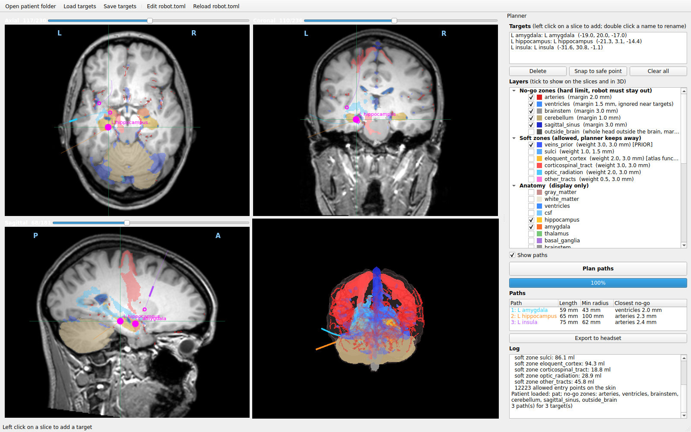

# Continuum robot path planner (desktop app)

Pick targets on the MRI slices, compute safe curved paths for a continuum robot, export them to the headset.
The headset only displays the result (brain + paths); all planning happens here.

## Use
1. **Open patient folder** - the output folder of `pipeline/run_pipeline.py` (needs `orig.nii.gz`,
   `aparc.DKTatlas+aseg.deep.nii.gz`, `head.nii.gz`, `mask.nii.gz`, the masks named in `robot.toml`, and
   `headset/headset_manifest.json`). Loading takes ~30 s (safety maps are computed).
2. **Targets**: scroll through axial / coronal / sagittal slices (mouse wheel, Shift = 5 slices),
   **left click** adds a target on the current slice, **right click** moves the cursor. Targets can be on
   different slices. Double click a target to rename it. A target that is itself inside a no-go zone is shown
   in red; *Snap to safe point* moves it to the closest safe point (max 5 mm).
   **Layers** (right panel, tick to show on the slices and in 3D; the planner always uses every zone,
   ticked or not). One tick per group shows or hides the whole group; expand a group to tick single layers.
   All no-go zones are shown at start (except *outside_brain*, which would cover the whole head).
   - *No-go zones* and *Soft zones* = exactly the zones the planner uses (from `robot.toml`), with their margins / weights
   - *Anatomy, Head* = display only (they do not change the plan): grey / white matter, CSF, hippocampus,
     amygdala, thalamus, basal ganglia, skull estimate, scalp. Structures that are already a zone
     (ventricles, vessels, eloquent cortex, tracts ...) are shown from their zone row, not twice.
     [PRIOR] / [ESTIMATE] / [atlas function] mark layers that are not measured in this patient
   **Target regions** (doctors usually mark an area, not a point): press **Draw outline** (or *New region*),
   hold the left mouse button and draw around the area on a slice of one view, then on a slice of a second view
   (e.g. axial, then coronal; the other views jump to the region after the first outline). The region is where
   the outlines overlap (each outline is extended through the volume along its view); with one outline only it
   is a 5 mm slab. *Region only inside the brain* clips it to the brain. Drawing again in a view replaces that
   outline. Regions are saved automatically to `regions.json` (outlines in RAS mm); *Save targets* also writes
   `regions/<name>.nii.gz`. When planning, the robot tip may end **anywhere inside the region**: the planner takes
   safe points at least 1.5 mm inside its edge, ranks them by the route cost from the skin (one Dijkstra from all
   allowed entries), plans the 3 best in full and keeps the cheapest; then the region is planned like a point
   target (also together with other targets on one path). The path list shows how many electrode contacts lie in
   the region. The region is exported to the headset as layer `region_<name>` (group *Target regions*).
3. **Plan paths** - for every target, and for groups of 2-3 nearby targets, the planner looks for a path;
   it then decides itself how many insertions are needed (one path through several targets when that is safe).
   Every target alone takes ~10-20 s. Groups are tried after that, most promising first, until
   `time_limit_s` (robot.toml, default 120 s); groups that cannot be shorter than separate paths are skipped.
   **Stop** ends the planning at any time; if the single paths are already done they are kept.
4. **Export to headset** - writes into `headset/` (about 1 min):
   - `plan.json` (targets, path points in mm and in headset metres, checks) and `paths.glb` (robot tubes + targets)
   - `patient_scene.glb` / `patient_scene_lite.glb` and the `layers` of `headset_manifest.json`: the brain model with
     **the same layers and groups as this app** (No-go zones, Soft zones, Anatomy, Head; outside_brain left out).
     The original model of `tools/export_headset.py` is kept once as `*_pipeline.glb` / `headset_manifest_pipeline.json`;
     landmarks and the coordinate system in the manifest are not changed.
   The Unity app (`PatientLoader` + `DesktopViewer`) loads all of it on Play: same groups, one tick per group.
   Copy the headset folder to the glasses as before.

## Robot constraints and no-go zones: `robot.toml`
The robot model (`robot_model.py`) is a concentric-tube robot: it is pushed in **straight** first (any length,
at least `min_straight_mm` for skin and bone), then **arc 1** (pre-curved tube, at most 35 mm, radius >=
`arc1_min_radius_mm`) and **arc 2** (thinner inner tube carrying the tip, at most 35 mm, radius >=
`arc2_min_radius_mm`). Each tube can be rotated, so each arc bends in its own plane. The inner tube is thinner and
can be bent more tightly without overstraining it, so by default arc 2 allows the tighter bend (30 mm vs 50 mm);
put the real values of the robot here. Wider arcs are preferred (`curvature_weight`). On the slices, in 3D and in
the headset the parts have their own colours: cyan = straight, yellow = arc 1, orange = arc 2; the path list shows
e.g. `straight 31 | arc 1 24 mm R 131 | arc 2 5 mm R 79`.
Other limits: robot diameter, maximum length, entry angle; no-go zones (hard, with safety margins)
and soft zones (preferred distance). Edit, save, press **Reload robot.toml**. No code changes needed.

| No-go zone (hard) | Source | Margin |
|---|---|---|
| arteries | TOF-MRA, automatic segmentation | 2 mm |
| ventricles | T1 segmentation | 1.5 mm (not checked right at a target) |
| choroid plexus | T1 segmentation | 1 mm |
| midline (falx, interhemispheric fissure, corpus callosum midline) | computed from the segmentation | 1 mm - a path never crosses to the other hemisphere |
| hypothalamus (ventral diencephalon), optic chiasm | T1 segmentation | 2 mm |
| brainstem, cerebellum | T1 segmentation | 3 mm, 1 mm |
| superior sagittal sinus | PRIOR from anatomical rules (no venography) | 3 mm |
| veins | PRIOR from the VENAT vein atlas (no venography) | 1 mm |
| corticospinal tract | DTI tractography | 1 mm |
| optic radiation (incl. Meyer's loop) | DTI tractography | 1 mm |
| outside the brain (after the straight entry) | brain mask | 1 mm |

Soft zones (allowed, the planner keeps away): deep grey nuclei (may be targets), sulci, eloquent cortex
(DKT atlas), other tracts (arcuate, uncinate, IFOF; DTI).

## Electrode contacts
The robot carries an SEEG electrode whose recording contacts are not continuous: there is one contact every
`contact_spacing_mm` (default 5 mm, `[electrode]` in `robot.toml`). Contact 1 sits at the tip, on the last target
of the path; the others follow back along the curved path every 5 mm of arc length (none in the straight entry
through skin and bone). `electrode.py` computes them; the app shows them with **Show electrode contacts**:
squares = contacts on the current slice, faint dots = contacts on other slices, green ring = a contact lying on a
target (contact centre at most `on_target_mm` = 1.5 mm from it). The path list says which contact records each
target and how far it is, e.g. `hip: #1 0.0 mm | amy: #4 0.8 mm`; a target that falls between two contacts is shown
in red. The export writes the contacts into `plan.json` (per path: number, depth from the tip, position, on target)
and as bands into `paths.glb` (`path_<n>_contacts` silver, `path_<n>_contacts_on_target` green), so the headset
shows them too.

## How a path is found
1. Coarse route on a 2 mm grid (minimum-cost path, `skimage.graph.MCP`): impassable in no-go zones,
   expensive near them and in soft zones.
2. The robot shape (straight + arc 1 + arc 2) is fitted to the coarse route and then optimised (`scipy` Powell,
   penalty continuation). It is built backwards from the target - tip direction, arc 2, arc 1, then straight
   back until it leaves the head - so the tip is exactly on the target and the skin entry follows from the shape.
   Hard: no-go clearance, arcs inside the brain, entry on the allowed skin zone, entry angle, straight part long
   enough, total length, earlier targets of a multi-target path within `target_pass_mm`. Cost: length + soft
   zones + bending (prefers wide arcs). Several starting routes (from different entries, straight lines) are tried.
3. Every result is checked against all hard limits; only paths that pass are used.
4. An integer program (`scipy.milp`) picks the set of paths that covers all targets with the lowest
   `path cost + insertion_cost_mm` per insertion. Paths used together must not collide: their robot bodies
   keep `min_path_distance_mm` apart and their skin entries `min_entry_distance_mm` apart. For every target
   up to 3 feasible paths from different entries are kept, so a clash is solved by taking another entry;
   a target that still cannot get a non-colliding path is reported in the log.
   Several targets on one path are strongly preferred (`insertion_cost_mm` = 150: an extra insertion costs as
   much as 150 mm of path). For a group the planner starts from exact shapes: (a) straight through the earlier
   targets, then one arc onto the last one; (b) the second-to-last target exactly where arc 1 meets arc 2, so the
   robot may already be curved when it passes it. A group is still rejected when no such shape keeps clear of the
   no-go zones (e.g. superior temporal gyrus -> insula crosses the middle cerebral artery branches in the Sylvian
   fissure).

## Build the Windows exe
Double click `build_exe.bat` (Python 3.11 must be installed). Result: `dist\ContinuumPathPlanner\ContinuumPathPlanner.exe`.
Without building: `run_app.bat` (or `python app.py`). Self-test without a window: `python app.py --selftest <patient folder>`.

Note: Windows Smart App Control may block an unsigned exe. If it does, use `run_app.bat`.

The 3D view uses pyqtgraph + PyOpenGL (pure Python, drawn by the system OpenGL driver). The earlier VTK /
pyvista view was blocked by Smart App Control (unsigned `vtk*.dll`). 3D mouse: left drag = rotate,
wheel = zoom, middle drag = move; buttons Front / Left / Right / Top reset the view.

## Test
`python tests/test_path_planner.py` - synthetic head: artery above a target, two targets on one line (one path),
target inside an artery (reported), Stop during planning, time limit, two crossing paths (alternative entry used).

Research prototype - not for clinical use.
