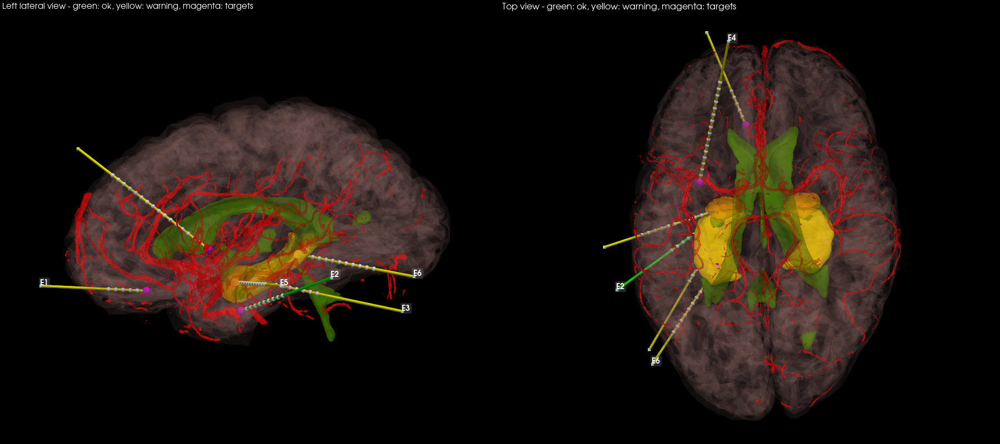

# Trajectory planner (SEEG electrodes)

Proposes electrode trajectories for a list of targets on the patient package, and writes `plan.json`
that the headset app shows (`unity/Assets/SeegPlanner/PlanViewer.cs`).

```
python planner/plan_seeg.py --package results/P/package --head results/P/head.nii.gz \
    --headset results/P/headset --targets planner/targets_example.json --png plan.png
```

## How it works
1. **Targets** come from `targets.json`: a brain region by FreeSurfer/DKT label (optionally its anterior,
   middle or posterior third) or any point in scanner RAS mm. If a region centre lies too close to a vessel,
   the tip is moved (inside the region, at most 4 mm) to the safest nearby point.
2. **Entry points** are skin points every ~3 mm, limited to the skull vault: not the face, frontal sinus,
   midline (sagittal sinus), ears, or below the floor of the middle cranial fossa (5 mm above the tragus).
3. **Each straight line** entry -> tip is sampled every 0.5 mm in the distance maps of the package.
   - Hard limits (line rejected): arteries < 2 mm, brainstem < 5 mm, ventricles < 2 mm, sinuses < 4-5 mm,
     length > 100 mm, drilling angle to the skin > 35 deg.
   - Soft risk (score): closeness to arteries, prior veins, sulci, eloquent cortex and white-matter tracts,
     plus length and angle. Parts of the path not covered by the vessel exam add risk.
   - Structures that naturally touch a target (ventricles next to the hippocampus, sulci, tracts) are
     ignored in the last few mm before the tip.
4. **Shared electrodes**: 2-3 targets within 3 mm of one line can share one electrode (it has 5-18 contacts).
5. **Selection**: an integer program (scipy `milp`) picks the set of electrodes that covers every target with
   the lowest `number of electrodes x 1.0 + total risk`.
6. **Contacts** are placed from the tip outward (2 mm contacts, 3.5 mm pitch, DIXI-like) while inside the brain,
   and the smallest electrode model (5, 8, 10, 12, 15, 18 contacts) that fits is chosen.

All rules and weights are at the top of `trajectory_planner.py` (`RULES`, `Settings`) - defaults for a research
prototype, to be tuned with the surgical team.

## Result on IXI057 (left mesial temporal example, `targets_example.json`)
6 targets -> 6 electrodes, ~20 s on a laptop CPU, all with >= 2.5 mm from imaged arteries.



## Test
`python tests/test_planner.py` - synthetic head: a vessel above the target forces a detour, and two collinear
targets end up on one electrode.

## Next
- interactive mode in the headset: pick or drag a target, re-plan on the laptop (small local server) and send
  the new trajectories back
- skull thickness at the entry (needs CT), real electrode catalogue, collisions between electrodes
